# NCCL 2.12.12 图解与原语内部逻辑

本讲解与仓库基线 `04832308d0885226169b9376c1ba4f17b0cb6484` 对应。Markdown页面的图片在visuals目录；单独阅读请下载内嵌全部图片、无需其他资源的 [离线图解](01_通信原语与算法图解_离线版.html)，可逐轮观察结果传播。[每个函数内部步骤](05_全部函数内部步骤_文件索引.md) 将文字说明定位回具体定义。

图中的“传输轮”“块”“完成”有明确层次：逻辑块可以被原语继续切成slice，slice占若干FIFO step，后端还可拆成网络请求/数据包。图中一条箭头不等于一个QP、一个WQE或一条CUDA指令。下面的4-rank示例假设环顺序为 `0→1→2→3→0`。

## 1. 先定位：谁做调度，谁真的搬数据

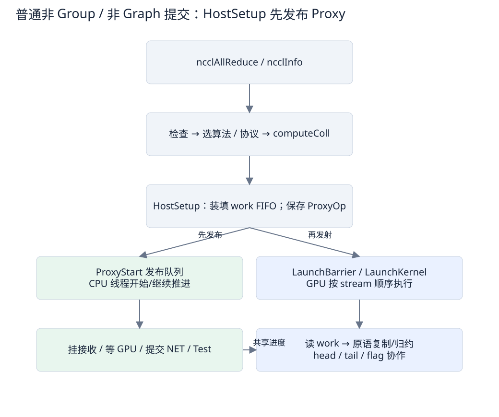

普通、非Group、非CUDA Graph路径从 `ncclEnqueueCheck` 进入。`computeColl` 同时写出两份计划：`ncclWorkElem` 交给GPU执行数据运算，`ncclProxyOp` 交给CPU代理推进网络。HostSetup把模板展开到实际channel：`bid` 表示本次操作的片段编号，`channelId` 表示实际通道槽，二者不一定相同。

这里必须按调用点辨认先后：HostSetup调用 `ncclLaunchProxy→ncclProxyStart` 发布队列，随后才进入LaunchBarrier/LaunchKernel。Proxy线程可以先准备接收或可写空间；发送数据时仍要等GPU就绪。邻近旧英文注释提到“发射kernel后启动代理”，不能用它推翻实际调用顺序。

`ncclLaunchKernel` 排入CUDA stream不等于GPU已经跑到该kernel，更不等于网络传输完成。图捕获模式把HostSetup放入图节点，在每次replay执行，不能照搬普通提交时CPU立即调用的时间轴。

## 2. 数据分片：先分地址，再按协议推进

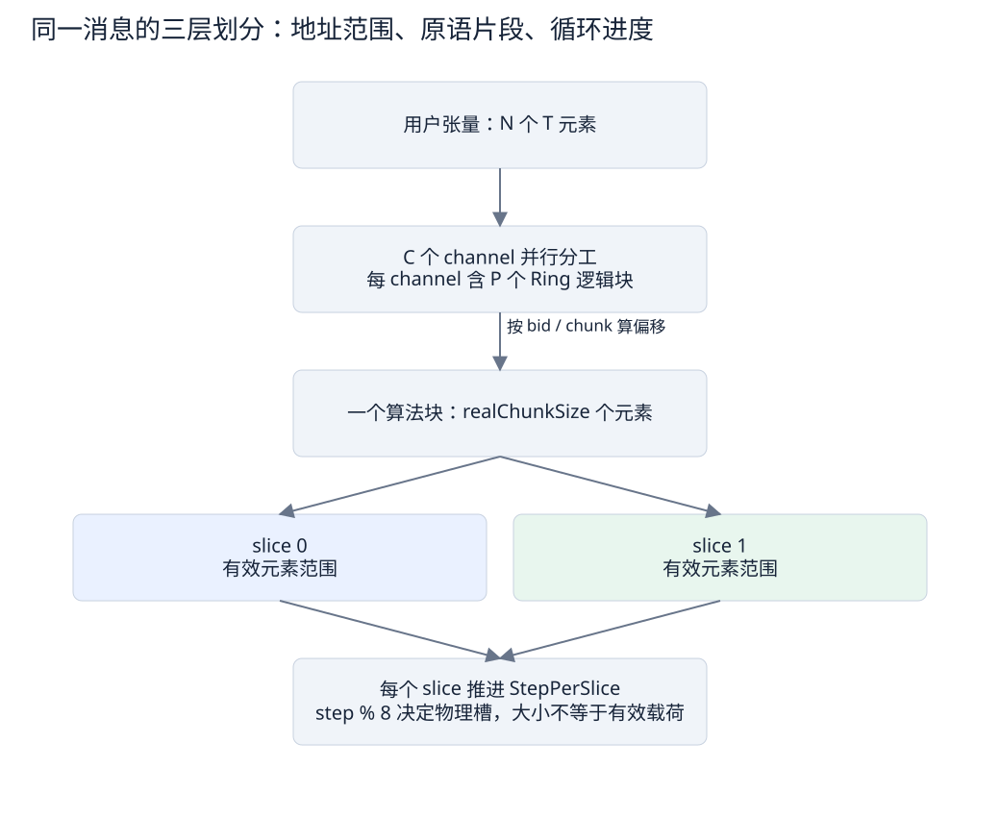

先分清三个问题：

| 层次 | 回答什么 | 关键变量 |
| --- | --- | --- |
| 算法地址划分 | 哪个channel负责哪些用户元素？环上先处理哪个块？ | bid、nChannels、nranks、gridOffset、chunk、realChunkSize |
| 原语片段 | 这次组合收发/归约分几片流水？ | SlicePerChunk、sliceSize、offset、nelem |
| 循环缓冲进度 | 可否写/读？复用哪一槽？ | step、StepPerSlice、head、tail、step%8 |

“把1GiB平均分成16份”只描述最外面的一层，还没描述环中块次序、原语片数、尾部对齐和缓冲复用。

### 2.1 主机computeColl怎样算协议容量

`stepSize = buffSizes[protocol] / NCCL_STEPS`，这里是**字节**，本版 `NCCL_STEPS=8`。Simple+Ring从API传入chunkSteps和sliceSteps；其他组合在这一步先按1处理。`chunkSize = stepSize × chunkSteps`。

Ring AllReduce使用 `chunkSteps=4`、`sliceSteps=2`，所以协议模板是 `ProtoSimple<2,2>`：一个算法原语块有两个slice，每片推进两步。它不意味着每片必须写满两个物理step的全部容量。

LL的16字节行只装8字节有效载荷，LL128的128字节行装120字节。因此主机计算覆盖用户张量的 `chunkEffectiveSize` 时要扣flag开销。若不扣，Proxy会少算轮数。

```text
nLoops = ceil(nBytes / (nChannels × nchunksPerLoop × chunkEffectiveSize))
Proxy.nsteps = nstepsPerLoop × nLoops × chunkSteps
Ring AllReduce: nchunksPerLoop=P, nstepsPerLoop=2(P-1)
```

AG/RS的 `nBytes` 是P段总规模；AG的设备count还已变成字节数。不能把不同API的公开count直接塞进同一式子。

### 2.2 设备Ring AllReduce怎样计算真实地址

`Proto::calcBytePerStep()/sizeof(T)` 已把有效字节转成**T元素数**。Simple设备循环先算本轮 `realChunkSize`，再按worker搬运粒度对齐：

```text
r = min(chunkSize, ceil((size-gridOffset)/(C×P)))
r = roundUp(r, (nthreads-32)×8/sizeof(T))
Simple offset = gridOffset + bid×P×r + chunk×r
LL/LL128 offset = gridOffset + (chunk×C+bid)×r
有效元素 nelem = min(r, size-offset)，进入原语后下限归零
```

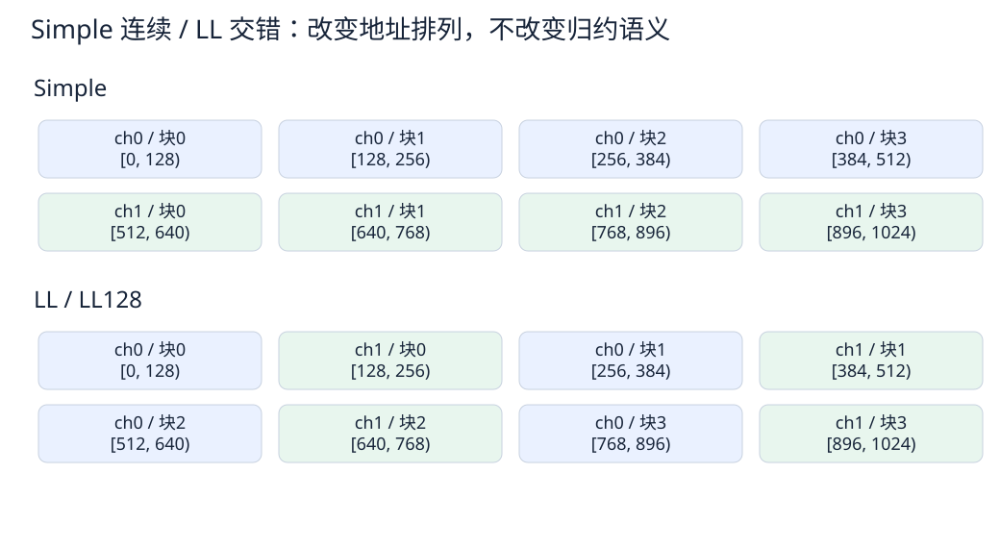

上图只比较**相同假设块长128**时两种地址排列，不表示同一调优配置下LL与Simple必然得到相同块长。LL/LL128实际还按自身最小grain计算。这里的 r 公式只属于 Ring AllReduce；AG/RS 的设备 size 是每 rank 段长，不能再除一次 P。Simple把同channel的P块连在一起，LL/LL128按块号与channel交错；两者都应恰好覆盖有效用户区间。

### 2.3 一套可手算的Simple示例

为了验证公式，固定已选好的 `P=4、C=2、T=float、nthreads=96`，并用16KiB物理Simple缓冲作尺寸示例。**这是固定内部变量的教学计算，不预测默认调度是否会给小消息选择两个channel，也不是要求设置生产缓冲大小。**

| 量 | 计算 | 结果 |
| --- | --- | --- |
| 一物理step | 16KiB/8 | 2048B=512float |
| 算法块上限 | 512float×4 | 2048float |
| 对齐粒度 | (96-32)×8/4 | 128float |
| N=1024时本轮块长 | ceil(1024/(2×4))，再对齐 | 128float |
| channel0 | 块0～3 | [0,512) |
| channel1 | 块0～3 | [512,1024) |
| 一原语slice有效长度 | max(ceil(128/(16×2))×16,512×2/32) | 64float=256B |
| 一个原语块 | 2个slice | 各推进2step，合计4step |

这个例子中每slice实际只搬256B，仍按2个step更新协议进度。**进度跨度、物理容量、有效字节数是三件事。** nLoops=1，环每方向需要6次块传输，Proxy预算是6×4=24step。设备代码有7个组合原语调用位置：初始send、两次recvReduceSend、一次最终归约兼首次结果转发、两次recvCopySend、最后recv；因为有只发和只收端点，不能把7简单乘4当作每方向步数。

### 2.4 尾块和空块为何不能直接return

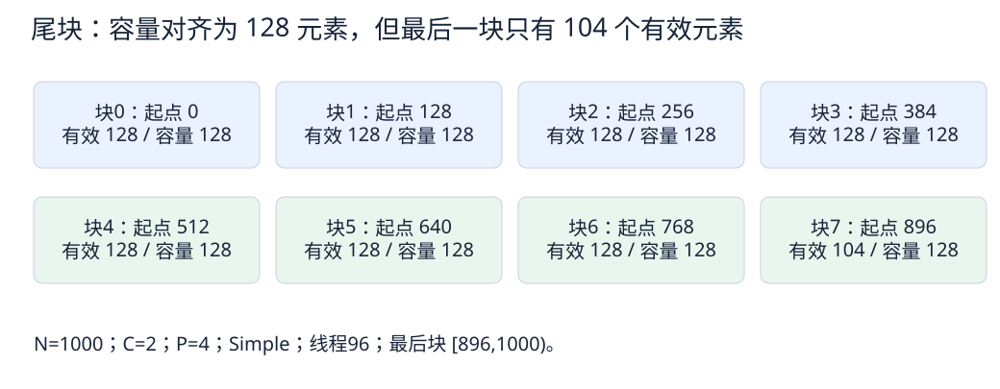

当N=1000，其余假设不变，r仍对齐成128。最后块从896开始，只能读104元素。算法容量没有变，实际复制必须截短；若某块起点已超出N，原语将非正nelem归零，但仍按约定片数等待/发布，保持双方step一致。

`gridOffset` 每轮按基准 `loopSize=C×P×chunkSize` 前进；尾轮的r可缩小。不能把尾轮r反过来改写前面循环已经确定的步进。源码检查工具附带多种N的地址覆盖核对，确保没有漏元素或重复覆盖。

### 2.5 同名 count/size 在三个 API 中为何不能混用

下面固定 P=4，公开 datatype=float、公开 count=8。count 对 AG 指 sendcount，对 RS 指 recvcount；表内 nBytes 是调度模型的规模，不是每条链路的实际流量。

| API | 单 rank 用户输入 / 输出 | ArgsCheck 后设备 T 与 size | 模型 nBytes | 设备 loopSize |
| --- | --- | --- | --- | --- |
| AllReduce | 8 float / 8 float | float，size=8 元素 | 32B | C×P×chunkSize |
| AllGather | 8 float / 32 float | Int8，size=32 字节 | 128B | C×chunkSize |
| ReduceScatter | 32 float / 8 float | float，size=8 元素 | 128B | C×chunkSize |

AG/RS 的 `chunkOffset=gridOffset+bid×realChunkSize` 在每个用户段内部切片；随后加 `rankDest×size` 选择输入/输出段。AR 的 chunk 则分割同一份 size，总共 C×P 个地址块。主机对 AG/RS 的 nBytes 乘 P，与设备每段 size 不乘 P，描述的是不同层次，并不矛盾。

还要区分两种“空”：整条 collective 的 count=0 时，这些 runRing 的 `gridOffset<size` 循环不进入；非空 collective 的对齐尾部可能给某个原语 nelem<=0，它仍需完成约定的 slice。Send/Recv 的零字节同步另走 P2P 的 do-while 路径。

## 3. 通信原语是“源→计算→目标”的组合

本节源/目标表以 Ring 单收单发为例，图中加号按 ncclSum 解释；Prod/Min/Max 等使用各自 RedOp。多接收邻居时，是否归约还应看实际 srcs 数量及模板，不能只凭名称里的 Reduce/Copy 判断。浮点贡献来源集合也不保证不同算法得到逐位相同的求和结果。

API里的AllReduce是全组语义；原语 `recvReduceSend` 是当前GPU、当前线程组、当前数据范围的一次组合动作。它不会单独发射一个新kernel。

| 原语 | 源 | 中间操作 | 目标 |
| --- | --- | --- | --- |
| send | 本地input | 读/必要preOp | 下游 |
| recv | 上游 | 读 | 本地output |
| copySend | 本地input | 一次读、多目标写 | output、下游 |
| recvCopySend | 上游 | 不再加本地input | output、下游 |
| recvReduceSend | 上游、本地input | 归约 | 下游 |
| recvReduceCopy | 上游、本地input | 归约、必要postOp | output |
| recvReduceCopySend | 上游、本地input | 归约、必要postOp | output、下游 |

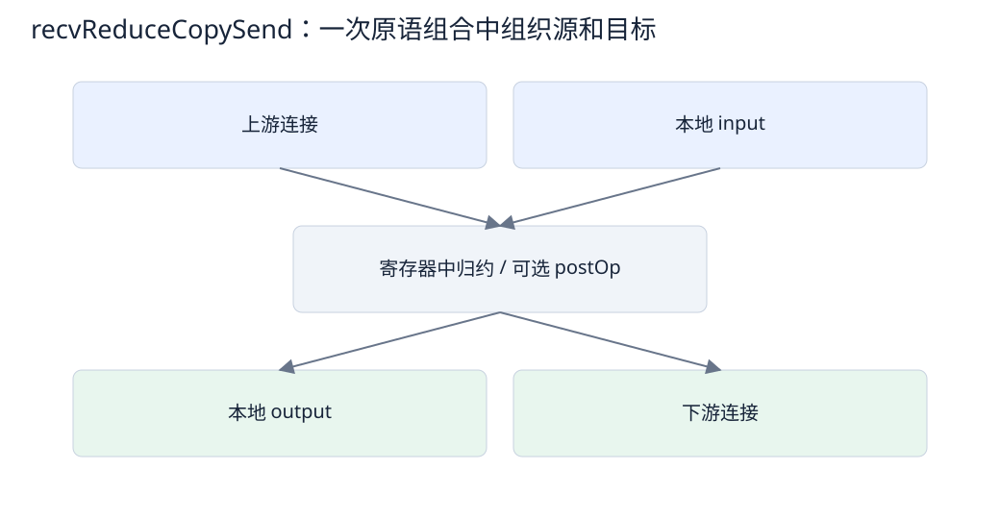

所有七种源/目标图都在 [图文件目录](visuals) 和离线图解中。名称里的Reduce表示合并本地原始贡献或多个接收源；Copy表示保留本地结果；Send表示同时向连接目标输出。

### 3.1 Simple模板参数逐位拆解

`genericOp<DirectRecv,DirectSend,Recv,Send,SrcBuf,DstBuf>` 的后两位选择Input/Output或-1，**-1表示没有这类本地源/目标**；不是远端rank=-1。

| 包装 | 模板实参 | 数据含义 |
| --- | --- | --- |
| send | `<0,0,0,1,Input,-1>` | 仅本地原始输入到下游 |
| recv | `<0,0,1,0,-1,Output>` | 仅接收并保留输出 |
| recvReduceSend | `<0,0,1,1,Input,-1>` | 收到上游，加本地输入，继续发 |
| recvReduceCopy | `<0,0,1,0,Input,Output>` | 收到上游，加本地输入，保留输出 |
| recvReduceCopySend | `<0,0,1,1,Input,Output>` | 一次加载归约，写本地及下游 |
| directRecvCopySend | `<1,1,1,1,-1,Output>` | 可直接接收/发送已完成结果，无本地输入归约 |
| directRecvReduceCopySend | `<0,1,1,1,Input,Output>` | 此包装的direct只对**发送部分**生效；接收仍按其普通归约路径 |

最后一行尤其容易被函数名误导：源码有注释“Direct is only for the send part”，不能把整个名字理解成所有内存访问都绕开中间缓冲。

### 3.2 归约为何要区分preOp和postOp

PreMulSum需要每个**原始输入**乘一次scale。一个输入沿环已经变成部分和后，不应再每跳重复乘scale。整数Avg则应等所有贡献相加完成才做除法，若每个输入先除会提前截断。

原语把实际 `srcs/dsts` 交给 `ReduceOrCopyMulti`，模板Src/Recv/Send/Dst决定多少个源和目标。先在寄存器中合并源，再把同一个结果写多个目标，避免“归约写临时数组→另起kernel读取再转发”。这是融合的来源。

## 4. Simple内部：不是所有线程执行同一份工作

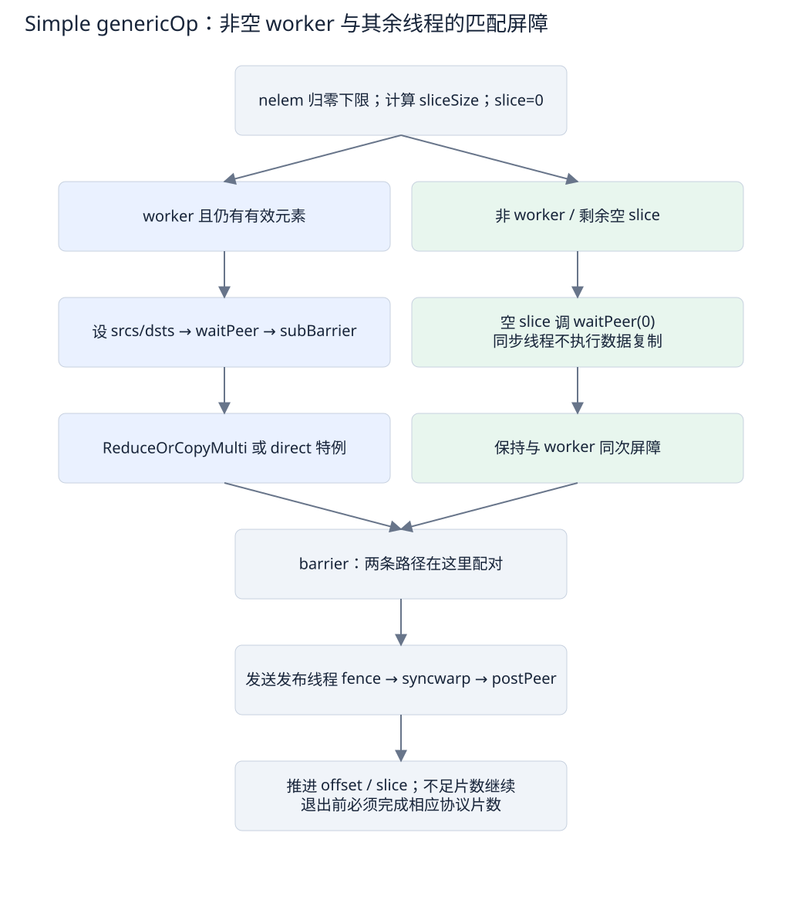

按源码顺序阅读 `genericOp`：

1. 把nelem下限归零，计算sliceSize与有效片段上限。小尾块会缩小实际搬运长度。
2. worker路径负责设置本地input/output指针、等连接、组装srcs/dsts。
3. `waitPeer`只由相应Wait角色真的执行流控/选地址。`subBarrier`让worker看见已经准备好的指针表。
4. 有三种数据路径：direct接收的源与目标重合时省复制；直接读的空发送特例；普通多源多目标融合路径。
5. 所有本组线程在匹配的barrier会合。非worker从另一个循环进入同一屏障，不能把它们当作提前退出。
6. 发送发布角色执行必要的系统fence，warp同步后postPeer，更新对外可见进度。
7. offset和slice前进。worker没有数据后也要完成剩余空slice的同步/发布，直到约定片数结束。

为什么把有效worker循环和剩余空片循环拆开？源码注释给出的目标是把worker热路径里的“是不是worker”“这片是否为空”重复判断移出循环，降低每个有效slice的分支开销；并非删除空slice的协议职责。

### 4.1 96线程的具体角色例子

对Ring 1收1发、nthreads=96，构造器会保留32个非worker线程，nworkers=64。同步角色按 `ThreadPerSync=8` 分配。下面只列有职责的代表线程；不是每个线程都有Wait/Post位。

| 线程 | g/index | 职责 |
| --- | --- | --- |
| tid0 | g0/index0 | RoleWaitRecv |
| tid1 | g0/index1 | RoleInput，提供本地输入地址 |
| tid8 | g1/index0 | RoleWaitSend |
| tid9 | g1/index1 | RoleOutput，提供本地输出地址 |
| tid80 | g10/index0 | RolePostRecv |
| tid88 | g11/index0 | RolePostSend |

Wait线程属于worker集合，还参与搬运。最后warp中的Post线程帮助把数据搬运与发布开销重叠。其他模板邻居度/线程数会改变有效角色；不能把这组具体tid推广到所有原语。

### 4.2 waitPeer的不等式

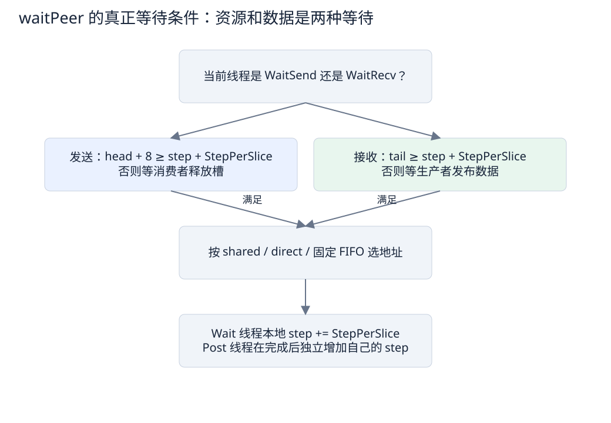

- 发送：`head+8 >= step+StepPerSlice` 才有空间；head由消费方推进。
- 接收：`tail >= step+StepPerSlice` 才能读取；tail由生产方发布。
- 循环中刷新缓存，并周期检查abortFlag，使异常时不必永久自旋。
- shared模式从offsFifo取得字节偏移；转成T*偏移时除sizeof(T)。普通模式使用 `(step%8)×stepSize`。

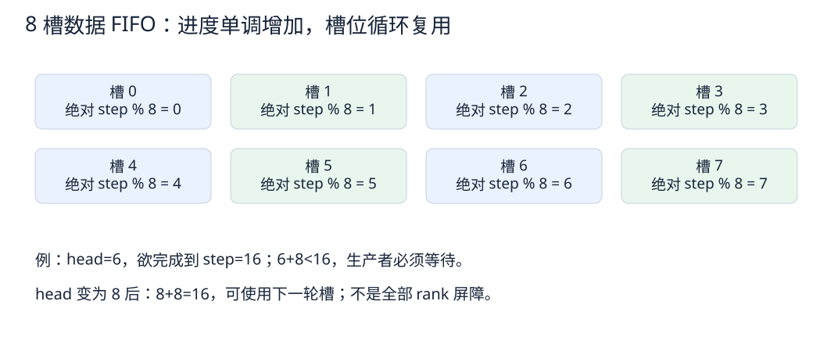

head/tail不是全组屏障：一个连接可以因为自己的消费者慢而阻塞，与另一条独立连接的进度不同。

### 4.3 为什么waitPeer加step，postPeer也加step，却没有翻倍

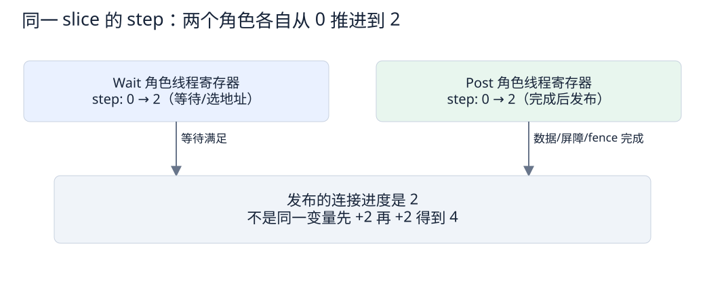

`step` 是原语对象在**每个线程寄存器中的独立成员**。Wait角色在waitPeer更新自己的step；Post角色在postPeer更新自己的step再写共享进度。它们通常不是同一个角色线程，也不是同一个内存变量从0连续加两次。析构时Post角色把最终step写回连接，下一操作接着用。

### 4.4 barrier、volatile、fence分别保证什么

| 机制 | 本处职责 | 不能替代什么 |
| --- | --- | --- |
| volatile加载/存储 | 编译器应按协议重新观察共享进度 | 不等于跨线程会合 |
| subBarrier/barrier | 参与组线程按相同阶段会合、看到指针/数据准备 | 不独立证明NIC已经发送完成 |
| threadfence_system | 发送进度发布前满足对应数据写的系统可见性顺序 | 不代表其他GPU已经消费 |
| head/tail/flag | 生产消费双方的协议进度 | 不等于API返回或CUDA事件完成 |

## 5. LL：用每16字节行的两个flag等待载荷

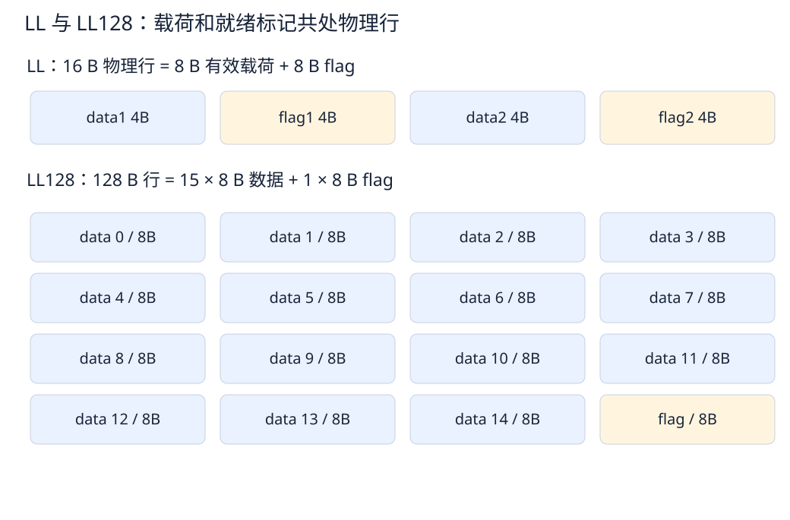

LL一行按 `data1,flag1,data2,flag2` 排列。接收者必须同时看到两个flag等于 `NCCL_LL_FLAG(recvStep+1)`，才取出两个data组成8字节有效值。普通构建的宏转换到 uint32；TEST_LL_CLEANUP 调试分支会使用更短的标记周期，不能无条件把未映射的64位step当成行flag。对端可能尚未写完整行，看到其中一个新flag不足以接受另一半旧数据。

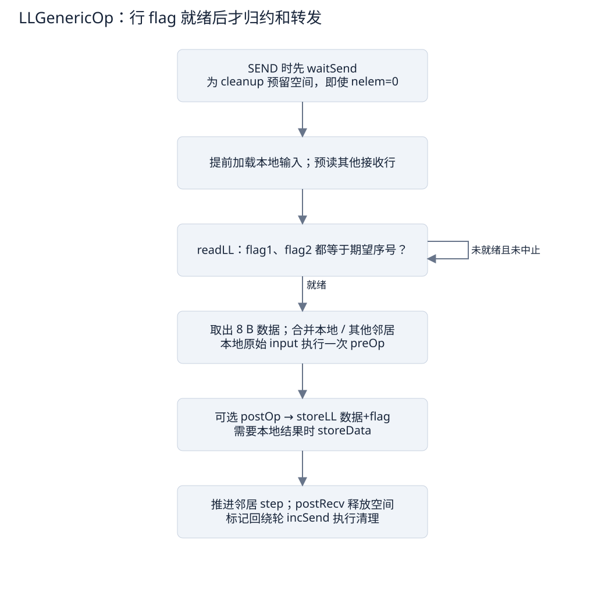

`LLGenericOp`内部按线程分配行：`offset=tid`，每轮offset增加nthreads；用户元素地址按 `eltPerTrip=nthreads×EltPerLine` 前进。本地加载先Begin，等待接收行时可以与加载重叠，再Finish取值。多接收邻居时逐个检查对应行并合并，postOp仅在要求的最终输出点执行。SEND把数据和本轮flag写到下游；DST再保留用户结果。

行内flag解决“这一行是否到达”，head仍负责“旧行能不能重写”。两种控制缺一不可。标记回绕时incSend清理未覆盖行，Proxy在清理轮可能需传整step，不能按本次有效用户字节过早裁掉。

本版代码依赖其明示的数据/flag布局与网络写入假设；一次128-bit汇编加载/存储并不意味着任意观察者都获得整行128-bit原子性。

## 6. LL128：warp协作、120/128有效率和加载重叠

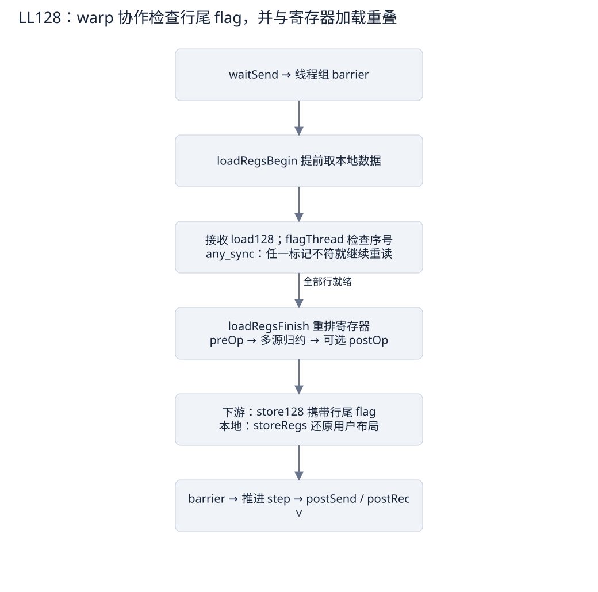

LL128每行16个uint64：15个数据字、1个flag。`flagThread`负责相应标记检查和写出，warp通过 `__any_sync` 决定是否仍需重读。任一负责标记的线程看到旧序号，整轮不能直接继续消费。

`loadRegsBegin`在满足16B对齐时直接预取寄存器；不对齐时借共享内存暂存覆盖区域。`loadRegsFinish`延后重排，尽量把重排依赖停顿与等待接收隐藏。随后逐源归约、可选postOp，再store128连同行尾flag发出；本地结果经storeRegs恢复用户布局。

`GenericOp`按warp分配DataEltPerSlice，通过nwarps跨步处理后续片段。结束时barrier，更新收发step，再postSend/postRecv。postSend用的是其源码中的fence与tail路径；NET代理在系统内存LL128发送时还会检查行flag。不要把Simple的同步图原样套到LL128。

## 7. direct、GPU P2P和GDR的逻辑不能合并理解

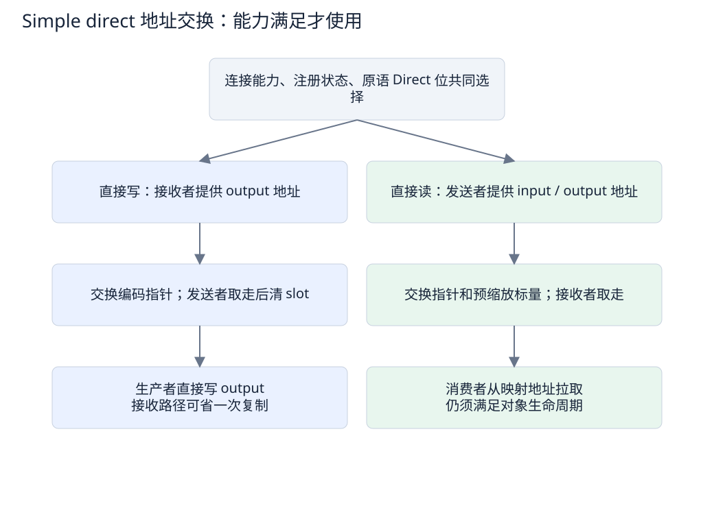

Simple的setDataPtrs先确定四种角色：recvProvider/sendAcceptor用于直接写，sendProvider/recvAcceptor用于直接读。指针交换槽用nullptr表示空；因此编码时与slot地址异或，允许合法空指针与“槽尚未提供”区分。使用方取走后清槽，提供方才可放下一轮地址。

直接读还要交换原始输入的缩放参数。标量拆成两部分，每部分额外设置非零有效标记，以便零标量也能与“未写入”区分。接收者重组标量，避免读取到旧参数或对原始贡献漏做preOp。

waitPeer只在具体谓词满足时省掉部分等待：`DirectRecv && Src && DirectRead` 与 `DirectSend && (DirectRead|DirectWrite)` 等；不是任何direct函数都无条件跳过同步。

LL/LL128通过 `PrimitivesWithoutDirect` 把同名direct调用退化到普通协议原语。Simple的 `directRecvReduceCopySend` 也只让发送部分direct。函数名是组合接口，不是硬件能力证明。

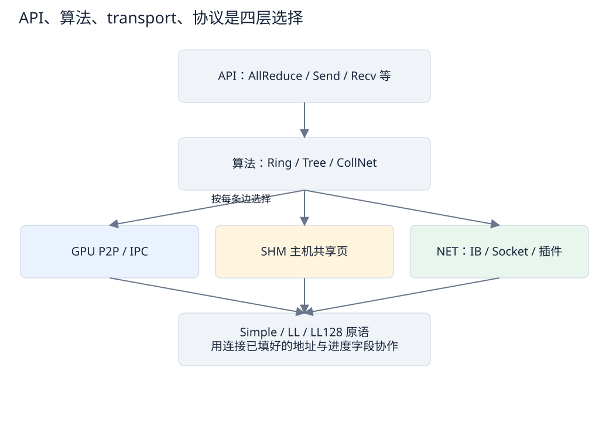

同机GPU P2P依赖可访问映射；跨进程通过CUDA IPC建立本进程地址。SHM使用GPU可映射的主机共享页。NET若支持GDR，NIC可访问注册GPU缓冲，但本版内置IB的WQE提交/CQ轮询仍在CPU Proxy中。GDRCopy是CPU映射显存的小数据/同步优化，不能与GPUDirect RDMA视作一个接口。

## 8. Ring AllReduce：把每个块的来源追到底

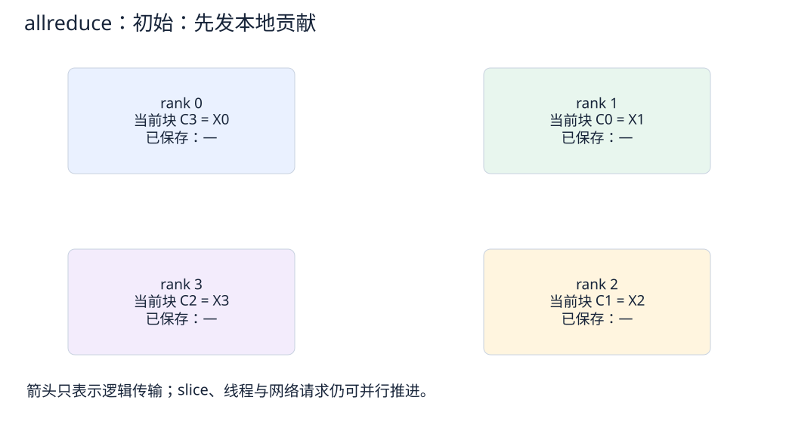

用 `Xr(Ck)` 表示rank r输入中第k块。在本图用户rank与ring.index相同的特例中，r首先发送C((r-1+P)%P)，每跳接收者把自己的同一块加入部分和。经过P-1个归约传输轮，每个rank完成自己内部环编号的块。

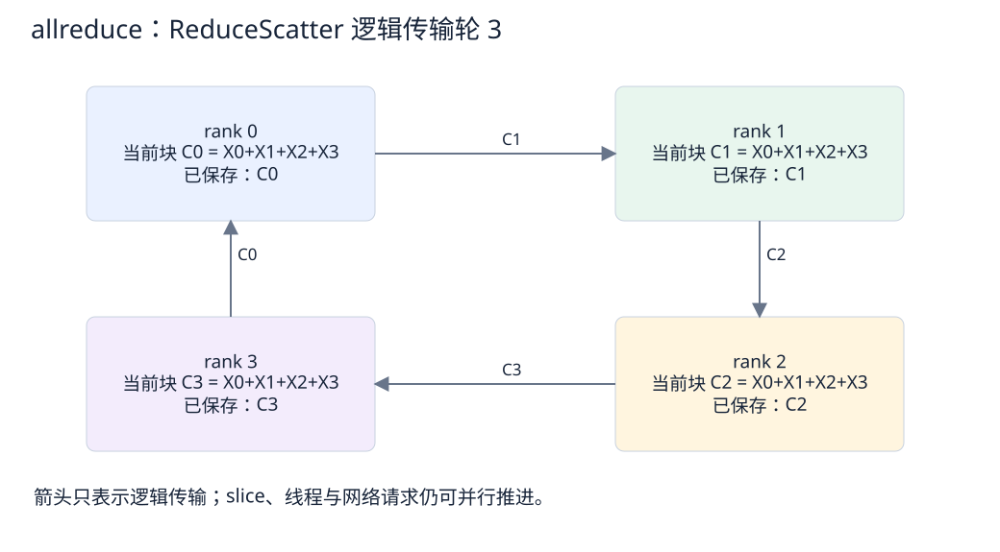

真实 `setupChannel` 用 `ring.index=(ixRank-ixZero+P)%P` 计算从用户rank0沿环走到本rank的距离；`devUserRanks` 则旋转为本rank开头。比如全局环为 `[2,0,3,1]`，rank3的index=1、本地视图为 `[3,1,2,0]`，AR暂存的最终块C1不等于RS必须输出的用户段3。

示例rank0的源码调用顺序如下。它描述7个原语调用点，不是7个独立kernel，也不是每方向7次网络传输。

| 顺序 | 块 | 原语 | 本地结果状态 |
| --- | --- | --- | --- |
| 0 | C3 | send | 发自己的贡献 |
| 1 | C2 | recvReduceSend | 加自己的贡献再转发 |
| 2 | C1 | recvReduceSend | 加自己的贡献再转发 |
| 3 | C0 | directRecvReduceCopySend(postOp=true) | 完整归约写本地，同时开始传播 |
| 4 | C3 | directRecvCopySend | 已完整结果只复制，不重复相加 |
| 5 | C2 | directRecvCopySend | 已完整结果只复制 |
| 6 | C1 | directRecv | 收齐最后结果 |

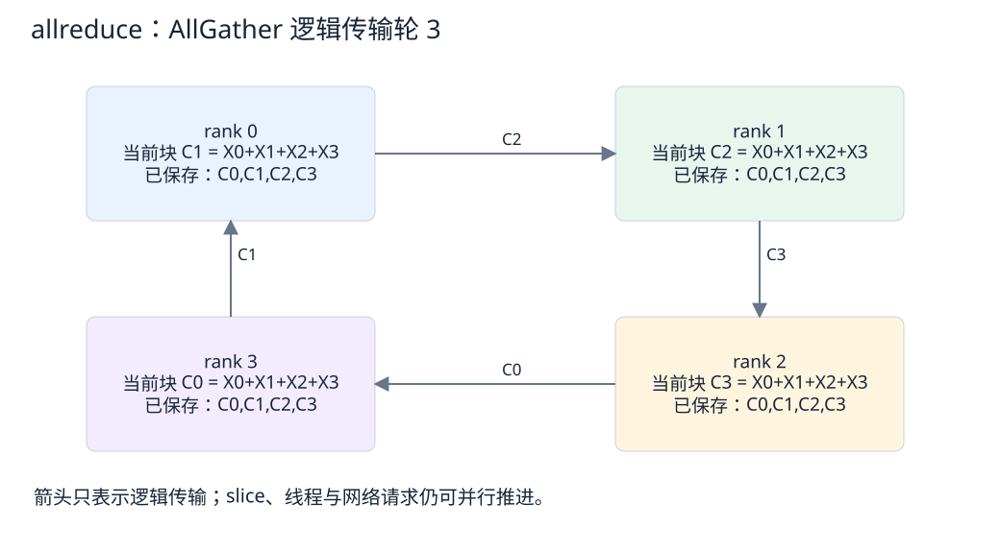

从一个块看，例如C0：rank1发X1(C0)→rank2加X2→rank3加X3→rank0加X0后成为完整结果，再复制到1、2、3。总共6条逻辑传输边，恰好是2(P-1)。最终“每rank都有结果”是第二阶段的效果，不是第一阶段每个rank都重复完成一遍所有块的归约。

## 9. AllGather与ReduceScatter：相似外形，不同语义

### 9.1 AllGather没有归约

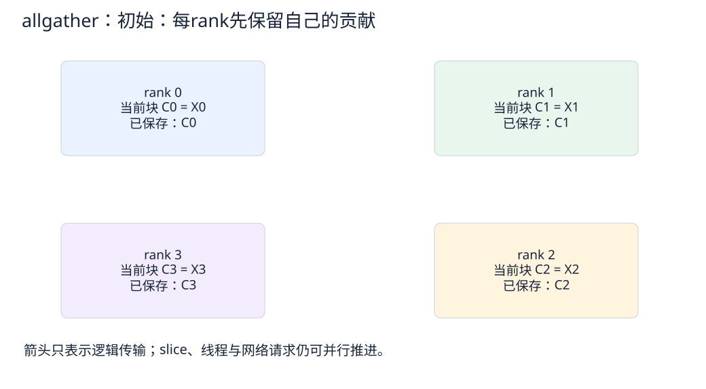

每rank仅贡献一段，输出按贡献者用户rank排列。环顺序可优化，但 `offset=chunkOffset+rankDest×size` 保持用户布局。自己贡献已在正确输出段时可直接发，否则copySend同时保留本地；中间recvCopySend；最后recv。

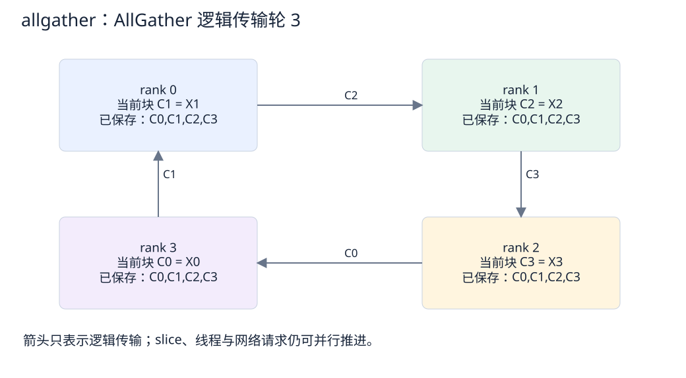

X0、X1、X2、X3只是相邻拼接，不能把X0+X1画成求和结果。公开sendcount=8 float时，ArgsCheck后设备size=32字节、总模型nBytes=128字节（4rank）；该复制API使用Int8。

### 9.2 ReduceScatter归约后只保留本段

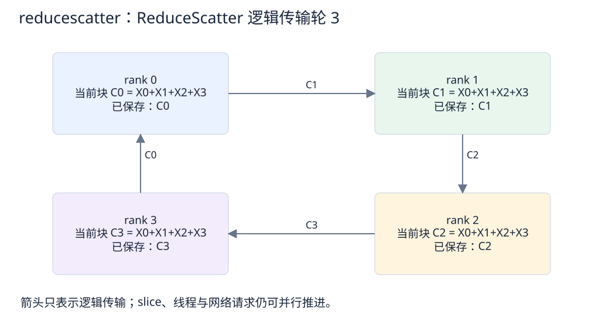

公开recvcount=8 float时，每rank输入32 float、输出8 float。设备size仍为8个float；访问输入时加 `rankDest×size`，输出只写自己的 `chunkOffset`。它不继续传播其他rank的完整结果，所以rank2得到全局归约结果中的第2段，而不是一个没有归约的原始输入段。

Ring AllReduce在单个设备算法中融合类似RS和AG的过程，并非主机真的先调用公开ReduceScatter再调用AllGather。

## 10. Broadcast与Reduce：在root处切断环

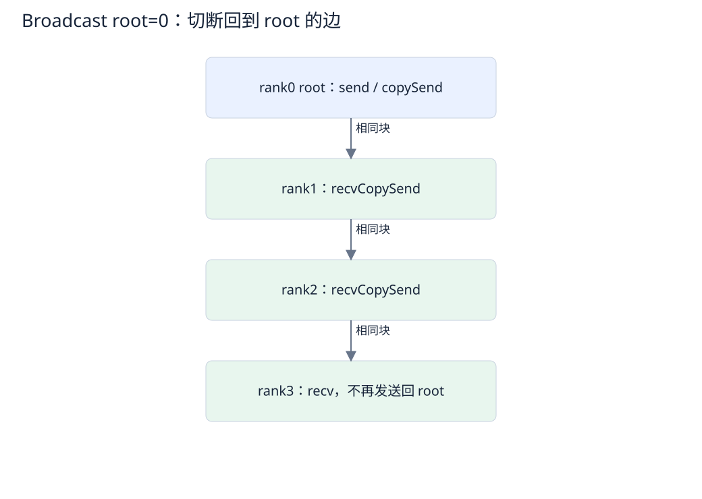

Broadcast root=0，只有root提供有效输入。root是send/copySend，中间rank保存并继续发，root前驱只recv，不发回root。各slice仍可流水，图中纵向顺序只表示单块依赖。

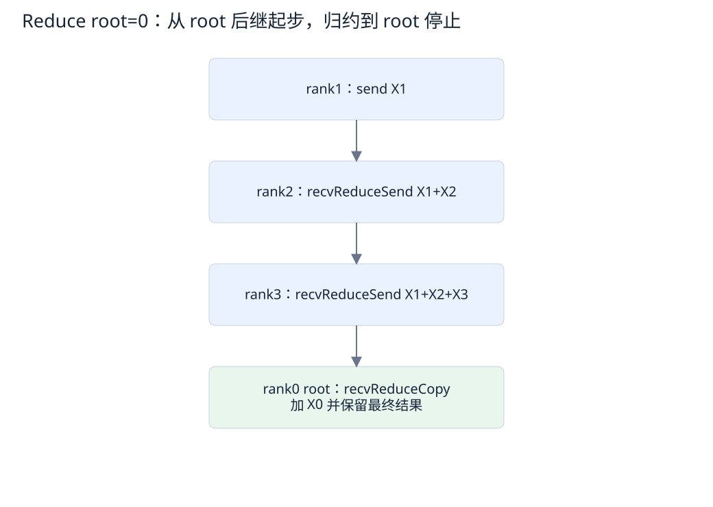

Reduce root=0从root后继rank1发起。rank2、3边收边加本地贡献，root最后加X0并存输出；结果只要求root有效，不再广播给所有人。

本版对应设备文件主要提供Ring特化。调度代码存在TreeUp/TreeDown的pattern名字，不能由枚举就推断这里有完整Tree Broadcast/Reduce设备实现。Tree图下面专门解释AllReduce路径。

## 11. Tree AllReduce与CollNet：改变依赖结构

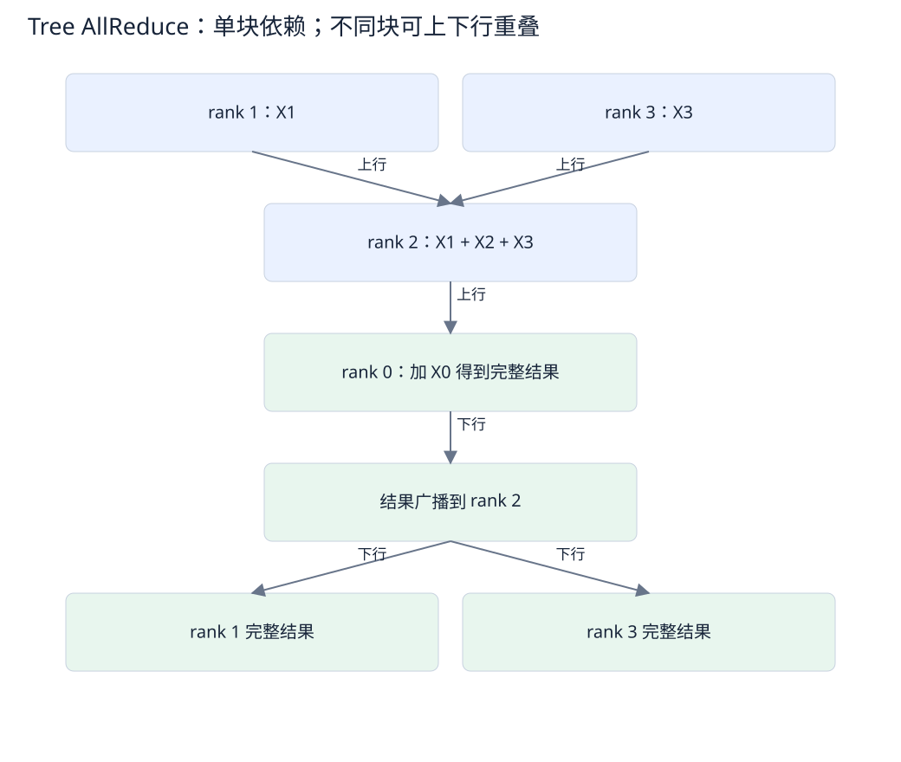

这是一棵4rank树的单块依赖示例：0为根、2为根的孩子、1和3为2的孩子。叶先send，中间节点多收一发归约，根完成结果，再向下传播。实际邻居由该channel的tree.up/down给出，不能把图中rank连接当成所有机器固定拓扑。

`runTreeUpDown`先完整上行再下行。`runTreeSplit`让非根的两个线程组分别服务上行和下行，组号/屏障分开，所以前一块下行可与后一块上行重叠。根用融合收、归约、复制、多目标发送衔接两个方向。源码另有CUDA版本/架构条件决定使用哪条实现，不能把Split当作永远启用。

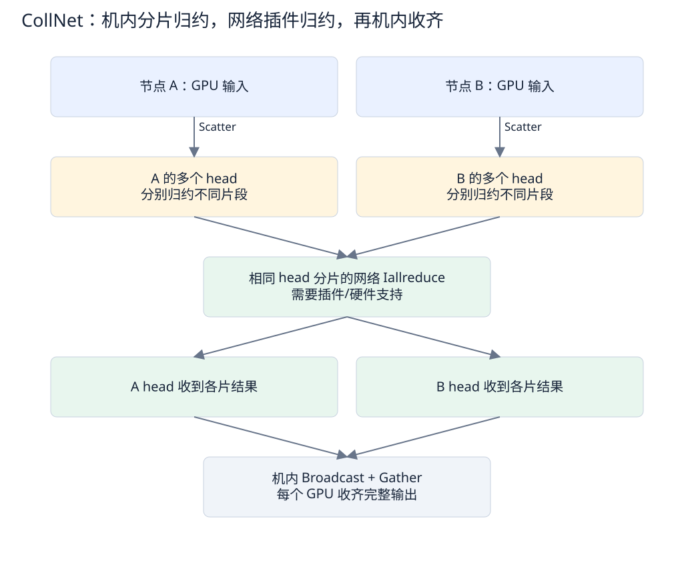

CollNet多出head分工：每个head负责不同张量片段，机内先Scatter/Reduce，网络插件对相同分片做Iallreduce，再Broadcast/Gather让机内每GPU收齐。`loopSize=C×nHeads×chunkSize`反映head维度。GPU代码按Scatter/Reduce/Gather/Broadcast线程组分工，不是全部线程顺序执行四段。

本版CollNet数据面仅Simple，要求插件/硬件和归约类型支持。不能用普通NET的Isend/Irecv图替代网络集合归约，也不能把普通IB QP总数直接当成交换机已支持硬件归约的证据。

## 12. Send/Recv及上层All-to-All

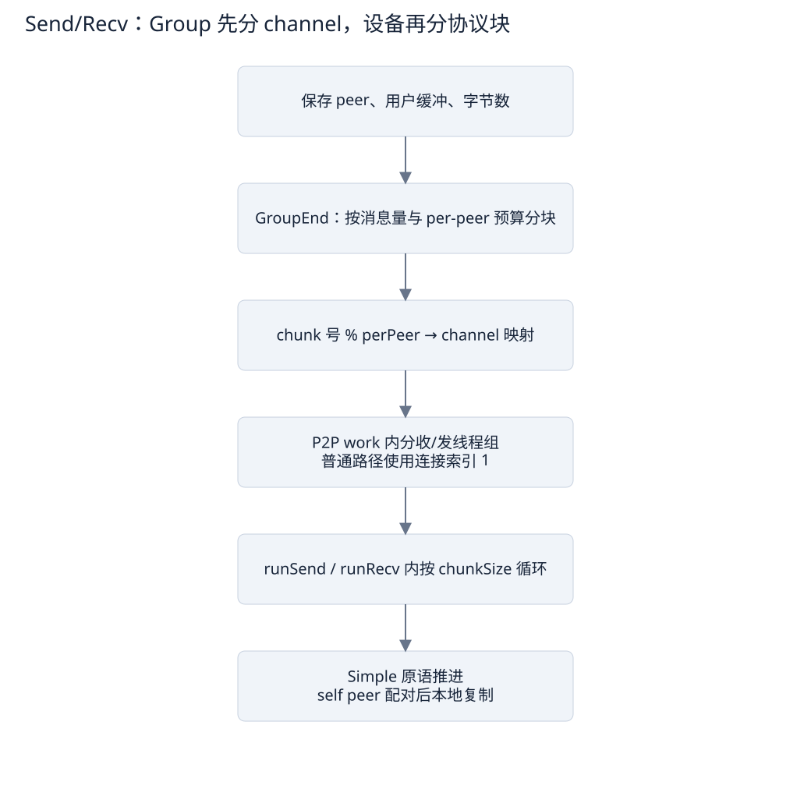

ncclSend/Recv内部套Group，外层应用也可以Group组合多个peer。SaveP2p按peer保存缓冲与字节数，并标记缺失的索引1连接；GroupEnd先预建链，再按节点距离/节点内序号一致地排收发，避免双方以不匹配次序各自等待。

第一层切块由getP2pChunkSize决定：每peer预算和总channel数量限制并行度，消息过大时可倍增所用channel，最后按step对齐。第二层在设备runSend/runRecv按chunkSize继续循环。零字节是同步语义，代码用do-while确保仍推进一次，不能与-1“无此方向任务”混同。

self peer需要匹配的send/recv元素，由发送组把输入复制到接收组缓冲，接收组不再重复搬运。非self使用Simple原语，连接能力决定走GPU P2P、SHM还是NET。

本版没有公开AllToAll/Gather/Scatter API；上层可以Group组织多peer Send/Recv来表达这些模式。其资源与调度取决于实际peer集合，不能把一个Ring邻居数拿来代表全互联模式。

## 13. Proxy与原语之间如何持续推进

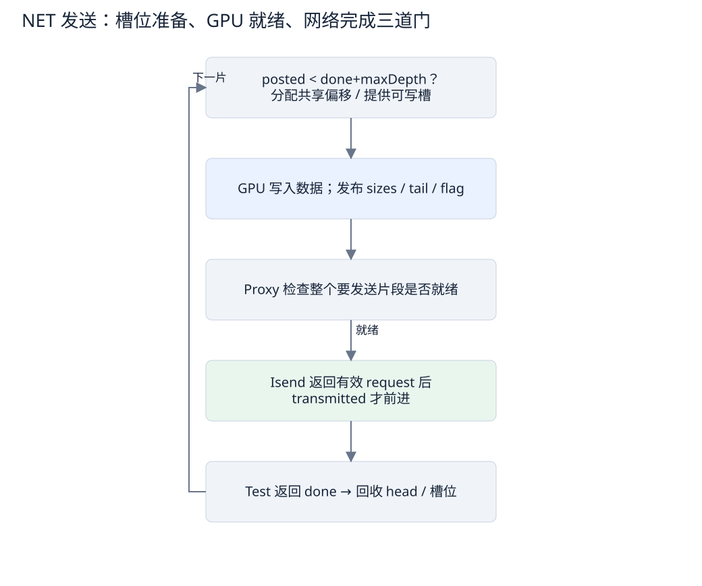

发送三道门：Proxy先提供槽位；GPU按原语生成有效数据并写sizes/tail或行flag；Proxy确认就绪才Isend。LL发送不要求tail先满足，而是检查两个行flag；LL128的系统内存发送还检查行尾flag，GDR分支条件另行处理。request非空后transmitted增加，Test完成后done增加并允许回收空间。Isend返回成功本身不允许GPU立刻覆盖NIC仍在读的缓冲。

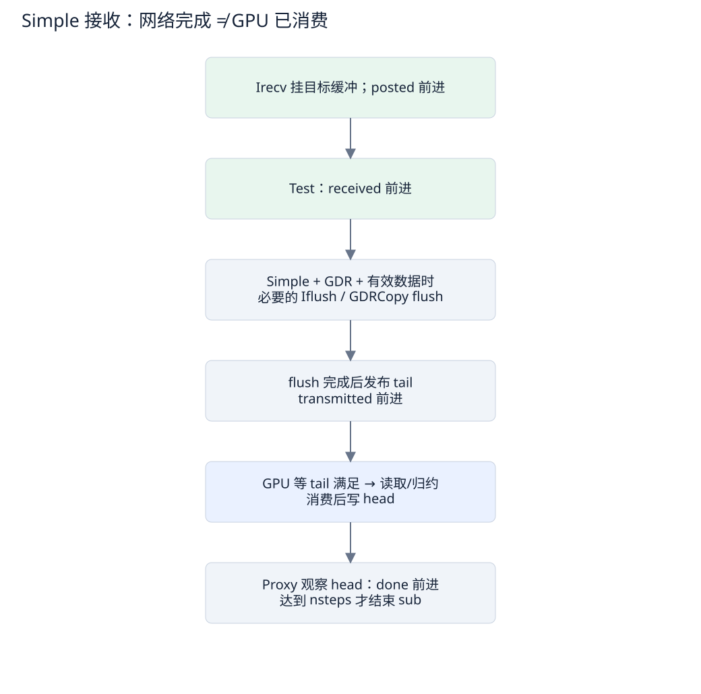

图中实线以 Simple 接收说明四道门：挂Irecv、网络Test完成、必要GDR可见性flush、GPU消费后head确认。网络完成后received前进，不代表GPU已经读取；Simple在可见性处理完成并发布tail后满足其waitPeer条件；消费再让done前进。LL/LL128设备接收按行flag判断数据就绪，可以与网络写入重叠，不能把CPU发布tail当成它们统一的读取门槛。Proxy仍跟踪received/transmitted/done并限制槽位复用。下列三个“完成”不能互换：后端request完成、GPU可以读、GPU已读并释放。

共享NET接收把同recvComm子项聚合交给Irecv，仍按maxRecvs上限组织；它是接口批量提交，不是verbs SRQ。GPU工作与Proxy工作必须对齐协议、连接和总步数，否则常见现象是一侧等tail、另一侧等sizes或CQ，表面上都在“忙”。

## 14. 对每个函数怎么读内部逻辑

源码的 `中文内部逻辑 F编号` 给出按函数体顺序的关键步骤；完整嵌套分支/循环在 [函数内部索引](05_全部函数内部步骤_文件索引.md) 的对应页面。它们逐项区分条件、循环初始化/继续/增量、数据写入、调用、return/goto/break/continue，不把if和else画成都会执行。

这些内部步骤是**源码结构展开**，配合上面人工拆解的协议语义来读。C++宏展开、模板特化、编译期条件与函数指针仍需结合具体配置；静态图不是CUDA指令时序，也不构成多线程无竞态的自动证明。解析器不能可靠拆分的片段会保留原文并标记，不能冒充已经验证的控制流。
