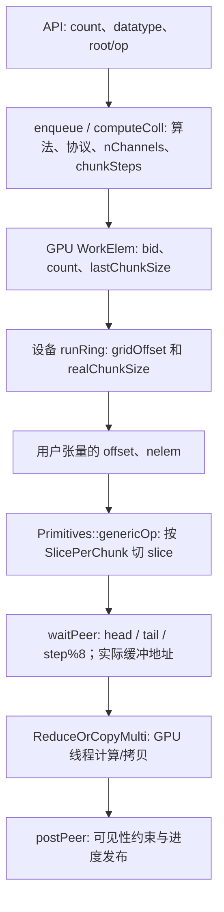
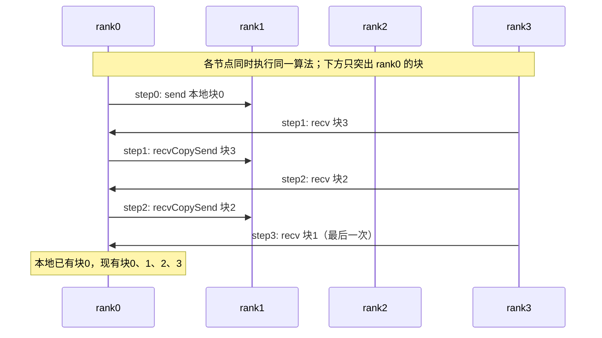
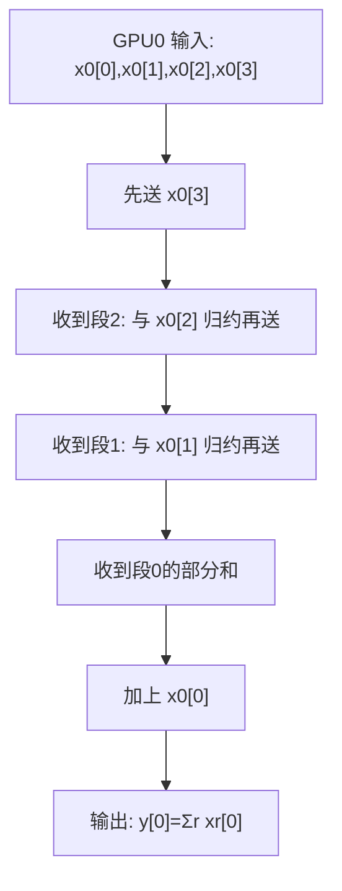
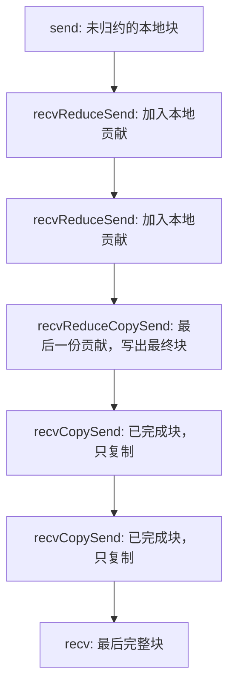
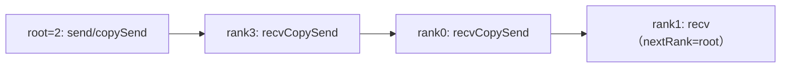
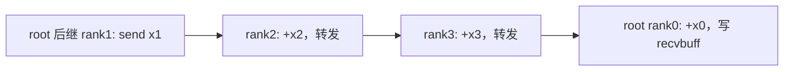
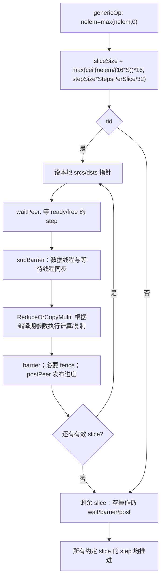
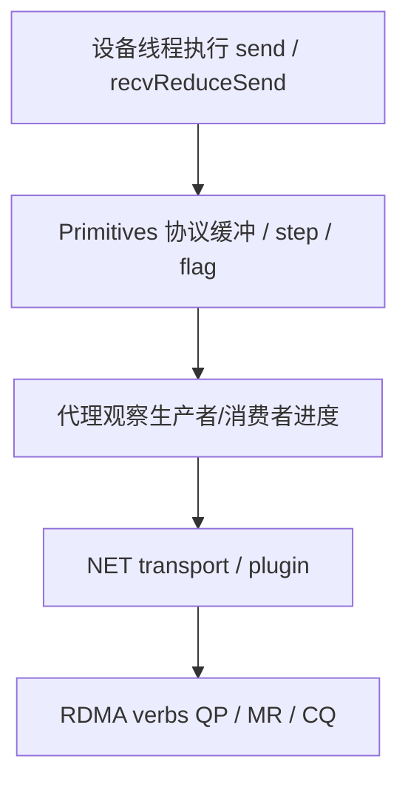

# V3.1 手工逐行精读：五类 Ring 集合通信、分片和同步

> 基线：NCCL 2.12.12（本仓库 master 起点 `04832308d0885226169b9376c1ba4f17b0cb6484`）。本章补充 **手工推导的跨 rank 因果链**，不是重复自动提取的函数语句清单。配合 [42 张原有图解](01_通信原语与算法图解.md)、[函数内部步骤](05_全部函数内部步骤_文件索引.md) 和 [Proxy/RDMA](04_Proxy_RDMA与QP_MR资源核算.md) 使用。

## 0. 第一件事：分清 5 种编号

| 名字 | 源头 | 不是什么 |
| --- | --- | --- |
| `comm.rank` | 本 communicator 的用户 rank | 不是此 GPU 在环里的位置 |
| `ring->index` | 从用户rank0沿该channel环走到本rank的距离：`(ixRank-ixZero+P)%P` | 不是用户 rank；不同 channel 可以有不同顺序 |
| `ring->devUserRanks[k]` | 以**当前 rank**为第 0 项的有序环视图；在 AG/RS 中拿到用户 rank，以此决定**逻辑分块归属** | 不是 `k` 本身一定等于用户 rank |
| `args->bid` | 本次 collective 的逻辑 channel 分块编号 | 不是设备 index，也不是 RDMA QP 编号 |
| `gridOffset` | 当前处理的多 channel 逻辑轮起点 | 不是链路 buffer 的 `step` |

教学图选取 4 rank 环 `0→1→2→3→0`，看 rank0 时 `ringRanks=[0,1,2,3]`。真实 Ring 可因 channel 改变顺序，计算时务必重新读取数组。例如全局排列 `[2,0,3,1]` 中，rank3 的 ring.index=1，devUserRanks=[3,1,2,0]；用户rank、全局数组位置和相对rank0的index并不相同。AR按index安排临时归约块，RS按devUserRanks里的用户rank安排输出归属。

### 数据先在哪里被切开？

**重要区别**：`chunkSize` 是算法块容量（设备侧以 `T` 元素为单位）；`realChunkSize` 是该轮真实分配的对齐块容量；`nelem` 是尾部有效元素数；`sliceSize` 是原语一次工作片段元素数；`step` 是循环缓冲的协议进度，单位不是字节。一个可见的 ring 箭头不是一次硬件 RDMA WQE。

## 1. AllGather：每张卡贡献一段，所有卡最后按 rank 顺序拼接

函数：[公开入口](../../src/collectives/all_gather.cc) → [设备 runRing](../../src/collectives/device/all_gather.h)。

用户语义：rank `r` 提供 `sendcount` 个指定 datatype 的元素，最终每个 rank 输出按用户 rank 升序排列的完整 `nranks * sendcount` 段。源码中的 `offset = chunkOffset + rankDest * size` 指向 **recvbuff 上 rankDest 的段**。注意 AllGather 在本版本 ArgsCheck 中会把 count 改成字节数、datatype 改成 ncclInt8，分析设备 `T` 时要沿实际 kernel/WorkElem 转换确认，不能把公开 datatype 长度直接假设等于设备 `size`。

**rank0 的逐步跟踪**（每个 rank 段只画同一个 `chunkOffset` 上的那一小块）：

代码中的索引精确为：
- `ringRanks[0]`：本地块，先 `directSend` 或 `directCopySend`。
- 中间循环 `j=1..nranks-2`：`ringRanks[nranks-j]`，`directRecvCopySend`。
- 最后 `ringRanks[1]`：`directRecv`，不用继续转发，因为这个方向的下一跳会是已拥有该块的节点。

`if (inputBuf+chunkOffset == outputBuf+offset)` 只是判断本地输入是不是已经落在 **recvbuff 的本 rank 对应位置**。为真不重复拷贝，只发送；否则 `directCopySend` 先落实输出布局再发送。此处的 `Direct` 是否实际落到远端直接地址，仍依赖对端连接协商及原语内条件，不能从函数名假定“必然零拷贝跨 RDMA”。

## 2. ReduceScatter：每张卡输入全部 P 段，只留下属于自己的归约段

函数：[公开入口](../../src/collectives/reduce_scatter.cc) → [设备 runRing](../../src/collectives/device/reduce_scatter.h)。

**这里 `size=args->count` 是每 rank 的输出段长度，不是整份 sendbuff 的总元素数。** 用户 sendbuff 需按用户 rank 组织 `P * recvcount` 元素；最终 rank `r` 只接收第 `r` 段归约结果（每段 recvcount 元素）。

对 rank0 的环视图 `[0,1,2,3]`：

| 阶段 | 读写用户段（rankDest） | 原语 | 此 rank 上的数据变化 |
| --- | --- | --- | --- |
| 首次发出 | `ringRanks[3]=3` | `send` | 把本地输入的段3送给 rank1 |
| j=2 | `ringRanks[2]=2` | `recvReduceSend` | 收 rank3 传来的段2部分和，加入本地段2，发到 rank1 |
| j=3 | `ringRanks[1]=1` | `recvReduceSend` | 收段1部分和，加入本地段1，发到 rank1 |
| 末次归约 | `ringRanks[0]=0` | `recvReduceCopy` | 收段0其他 rank 的部分和，加本地段0，写到 **recvbuff + chunkOffset** |

要紧的是 `recvReduceCopy(offset, chunkOffset, ...)` 的 **两个地址不相等**：第一个 `offset=chunkOffset+rankDest*size` 是输入多段中的那一段；第二个 `chunkOffset` 是本 rank 输出紧凑段的位置。只说“ReduceScatter 做了归约”会漏掉这里最容易写错的寻址细节。

## 3. Ring AllReduce：ReduceScatter + AllGather 融合在同一个 GPU kernel 路径

函数：[设备 runRing](../../src/collectives/device/all_reduce.h)。

每个 `gridOffset` 轮中，`loopSize = nChannels * nranks * chunkSize`；Simple 协议地址：
`gridOffset + bid * nranks * realChunkSize + chunk * realChunkSize`；
LL/LL128：
`gridOffset + (chunk * nChannels + bid) * realChunkSize`。

以 rank0、`ringIx=0`、`nranks=4` 为例，**必须把地址块索引与来源贡献者两件事分开**：

| 源码阶段 | `chunk` | 设备调用 | 结果包含哪些 rank 的同一块贡献 |
| --- | ---: | --- | --- |
| 首发 | 3 | `send` | GPU0 本地输入块3 |
| RS j=2 | 2 | `recvReduceSend` | 加上从前驱收到的块2部分和并转发 |
| RS j=3 | 1 | `recvReduceSend` | 加上从前驱收到的块1部分和并转发 |
| RS 最后 | 0 | `directRecvReduceCopySend` | 归约块0；保存到 output 并开始转发完整结果 |
| AG j=1 | 3 | `directRecvCopySend` | 接收完整块3、保存并转发，不再归约 |
| AG j=2 | 2 | `directRecvCopySend` | 接收完整块2、保存并转发，不再归约 |
| AG 最后 | 1 | `directRecv` | 接收完整块1、保存，不再转发 |

**这里有 7 个原语调用点，但不是一个 chunk 在每个 rank 必须连续经过 7 次归约。** 同一时间各 rank 分别处理不同 chunk，沿环传播。仅前半段参与 `RedOp` 归约；后半段绝对不能再加一次本地输入，否则结果错误。

## 4. Broadcast：以 root 为起点，只沿环发送一次，不归约

函数：[设备 runRing](../../src/collectives/device/broadcast.h)。

设备端判断如下（root 指 communicator 用户 rank，不是 `ring->index`）：

| 当前 GPU 条件 | 原语 | 为什么 |
| --- | --- | --- |
| `rank==root` 且输入输出同址 | `send` | 数据已在输出位置，不做无用拷贝 |
| `rank==root` 且输入输出不同址 | `copySend` | root 也要留下本地完整输出 |
| `rank!=root && nextRank==root` | `recv` | 这是沿环的最后一个接收者，不应再把数据发给 root |
| 其他非 root GPU | `recvCopySend` | 收到、写本地输出、转发给后继 |

图是 0→1→2→3→0 环、root=2 时 **从 root 开始重新绕环** 的单向传输序列 `2→3→0→1`。如果把 `rank==nranks-1` 写死为末尾，root 不为 0 时就错。

## 5. Reduce：流向 root 的单向部分和流水

函数：[设备 runRing](../../src/collectives/device/reduce.h)。

- `prevRank==root`：沿环紧跟 root 的 GPU 是“起点”，没有来自本次 reduce 流水的前驱部分和，直接 `send` 本地输入。
- `rank==root`：是“终点”，`recvReduceCopy` 把上一段部分和与 root 本地输入合并，**只在 root 写输出**。
- 其他 GPU：`recvReduceSend`，既参与归约又接力传送。

上图以 root=0 示范。若 root=2，起点换成 rank3，经过 rank0、rank1，最后到 root rank2。代码按 `prevRank==root` 而不是 `rank==0` 查找起点。

AG/RS每段内部的 `loopSize=C×chunkSize`；AR对整个张量使用 `C×P×chunkSize`。不能把上面AR的除以C×P和地址公式套到AG/RS。本文step0/step1等表示当前rank的算法调用阶段，不是全组屏障或FIFO step；一条send与对端recv是同一次逻辑传输的两端。

## 6. Simple 原语为何分两段循环？为什么 nelem=0 也要推进？

源码：[prims_simple.h::genericOp / waitPeer / postPeer](../../src/collectives/device/prims_simple.h)。

`SlicePerChunk` 决定一个原语算法块要走几轮；`StepPerSlice` 决定每轮推进几个协议 step。`NCCL_STEPS=8`，通过 `step%NCCL_STEPS` 选取循环槽；当发送者要覆盖尚未被消费的槽位时，`waitPeer` 的发送方向会检查 `connStepCache + NCCL_STEPS < step + StepPerSlice`。接收方向等待生产者把对应 step 推进。不同角色在构造函数中被分配给特定线程，**不是每条线程都在自旋或都负责 memcpy**。

工作线程执行有效字节的 `ReduceOrCopyMulti` 后要经过屏障和必要的内存可见性操作，然后 `postPeer` 通知 peer；剩余的空 slice 也必须推进约定的 step，否则发送/接收会因双方 step 不一致卡死。在已约定执行的原语中把 `nelem<=0` 直接 `return` 会破坏双方进度；但这不等于 count=0 的整个collective会进入上述runRing循环。P2P零字节同步需单独看Send/Recv设备循环。

`ReduceOrCopyMulti` 的模板参数决定输入源数量 `Recv*fan.nrecv()+Src` 和输出目的数量 `Send*fan.nsend()+Dst`；`postOp` 在需要完成最终归约的阶段才为真（例如 RS 最后一步和 AR 的最终归约阶段），它不是每个网络包都调用的归约参数。

## 7. 原语调用不直接等价于 RDMA WQE

这里仅给 **逻辑分层**：具体 GPU→GPU 本地 P2P、SHM 与跨机 NET 的路径不同；并非每个原语都需要 CPU proxy，更不意味着每个 slice 对应一个 QP。一个 channel 可以通过其已建立的 transport 连接复用网络资源；`NCCL_IB_QPS_PER_CONNECTION` 是 NET/IB 的连接级配置，不是每次 `recvReduceSend` 额外创建的 QP 数。

## 8. All-to-All 不要和本版的 Ring AllGather 混为一谈

本仓库 2.12.12 公共入口有 AllReduce、AllGather、ReduceScatter、Broadcast、Reduce、Send/Recv；不能凭另一个版本的 `ncclAllToAll` 名称去这里硬找同名入口。框架要实现 all-to-all，可基于 rank 对的 `ncclSend/ncclRecv` 分组安排；其实际 peer 连接数、channel、代理队列和网络资源取决于具体调用模式及版本实现。某些框架可能用 AllGather+局部切分实现 all-to-all 的等价语义，但成本和通信拓扑不等价，不能直接按此处 4-rank Ring 的 P−1 步数推导 QP/MR。

## 9. 源码定位 / 自检问题

1. 看 `all_gather.h` 的 `rankDest * size`：为什么最终输出不按内部环位置排序？
2. 看 `reduce_scatter.h` 的 `recvReduceCopy(offset, chunkOffset,...)`：为什么源偏移与目标偏移不同？
3. 看 `all_reduce.h` 的 `directRecvReduceCopySend`：为什么下一步只 `recvCopySend`？
4. 看 `broadcast.h` 的 `nextRank==root`：root=2 时谁是尾结点？
5. 看 `reduce.h` 的 `prevRank==root`：root=2 时谁先发送？
6. 看 `prims_simple.h` 的第二个 `while(slice < SlicePerChunk)`：没有有效数据为什么不跳过？
7. 追 `ncclEnqueueCheck → computeColl → HostSetup → GPU kernel / Proxy`：哪个对象携带用户元素区间，哪个对象携带网络 step 预算？

**核对边界**：本文展示了设备算法的环路径和 Simple 原语，实际算法/协议由调优选择；CollNet/Tree 的路径、P2P 和不同版本不能照搬这些分支；四 rank 示例只验证逻辑和索引，不等于真实硬件调度、QP 或吞吐量测试。
