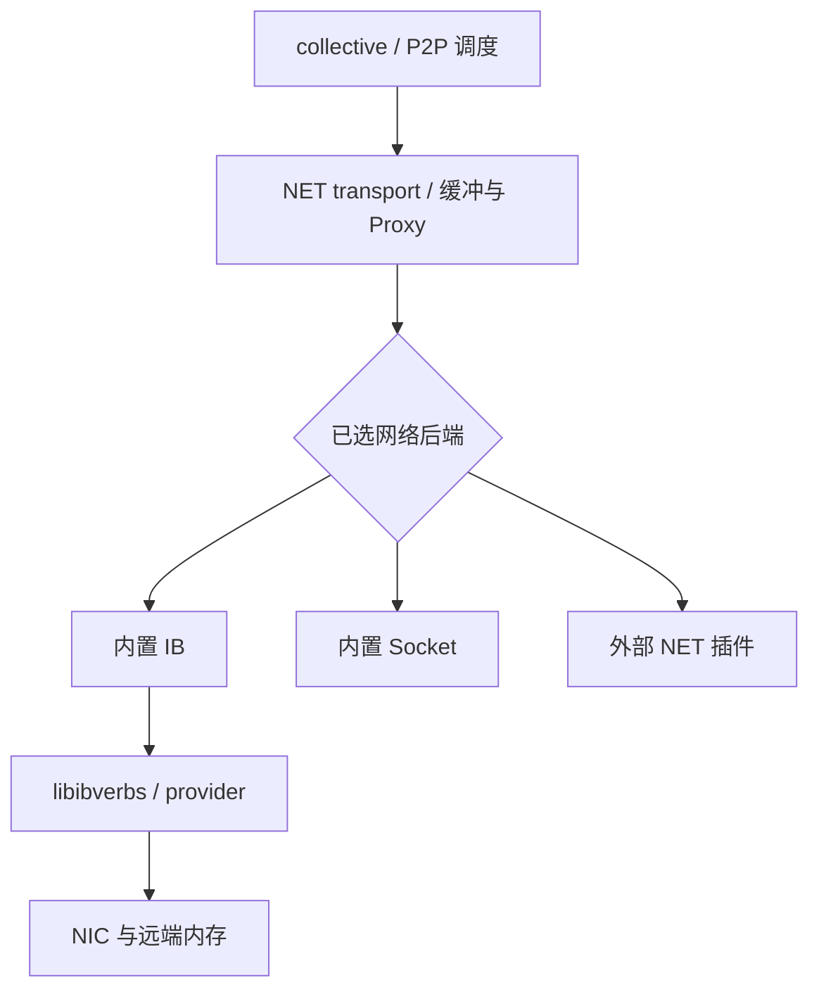
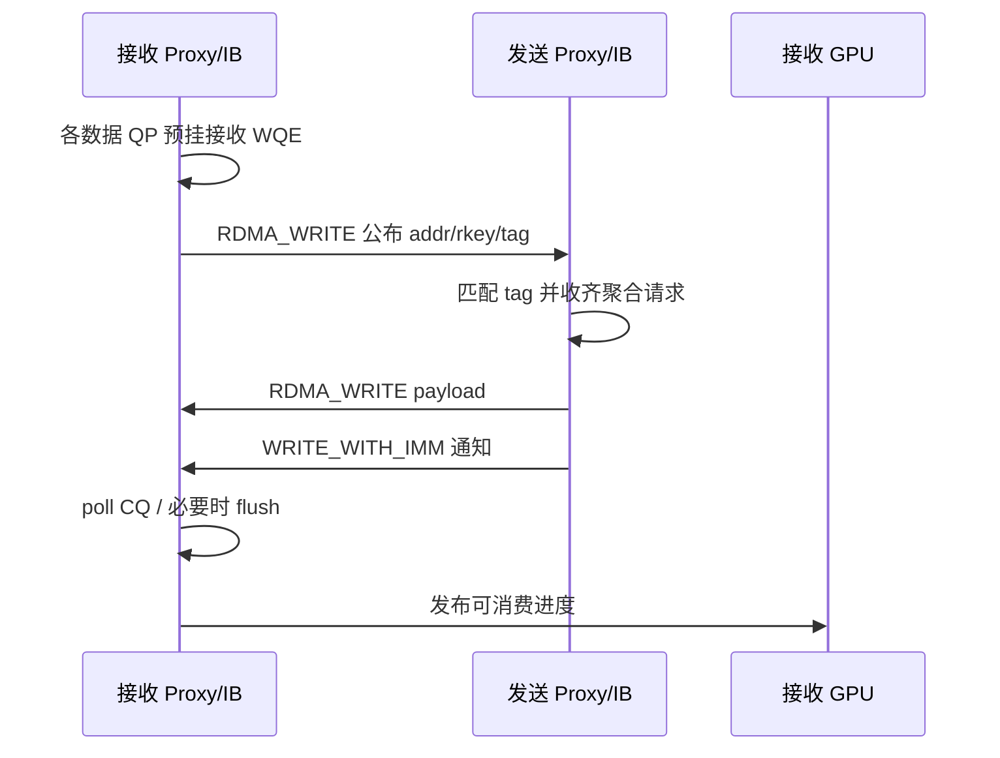

# Proxy、IB 与 QP/MR 资源核算

[返回总览](README.md) · [初始化与执行](03_初始化_Channel生成与Kernel执行.md)

分析基线：`04832308d0885226169b9376c1ba4f17b0cb6484`。本页重点针对该仓库的内置 IB 后端。外部 UCX/SHARP 等插件、Socket 后端与较新 NCCL 的实现必须另查，不能直接沿用这里的资源公式。

## 1. 先划清四层接口



[transport/net.cc](../../src/transport/net.cc) 负责把 GPU/Proxy 工作接起来，通过 [include/net.h](../../src/include/net.h) 的 ncclNet 回调调用实际后端。

[src/net.cc](../../src/net.cc) 先尝试外部 `libnccl-net.so` 或 `NCCL_NET_PLUGIN` 指定名称对应的库，解析 v5/v4 接口；后续选择顺序包含插件、内置 IB、内置 Socket，并可被 NCCL_NET 筛选。

这意味着“用了 NCCL”不能推出“用了 UCX”，也不能推出“用了 nccl-rdma-sharp-plugins”。要以加载日志、后端名称和实际动态库为准。本仓库的默认加载入口不是名为 NCCL_PLUGIN_P2P 的开关。

## 2. Proxy service 和 progress 为什么分开

见 [proxy.cc](../../src/proxy.cc) 与 [proxy.h](../../src/include/proxy.h)。

| 线程/状态 | 工作 | 主要函数 |
| --- | --- | --- |
| service | 接收 Init、Setup、Connect、Close 等资源请求；重试未完成的异步建链 | ncclProxyService |
| progress | 拉取数据传输任务并反复调用 transport progress | ncclProxyProgress |
| 主线程发布状态 | 把紧凑 ProxyOp 写入相应代理的任务池 | ncclLocalOpAppend、ncclProxyStart |
| transport 数据状态 | 保存每个子操作的 posted/received/transmitted/done 等 | ncclProxyArgs、ncclProxySubArgs |

代理资源建好后，不是每次 API 都重新创建线程、QP 和 MR。新操作通常只产生工作描述，复用现有连接和缓冲。

PXN 时，发送工作可以交给同机其他 rank 的 Proxy。计算每颗 GPU/RDMA 芯片的容量时，必须按实际 netDev/代理归属汇总，不能只按发起 API 的 rank 归属。

## 3. GPU、Proxy 与 NIC 如何合作

在内置 IB+GDR 典型路径中：

1. GPU kernel 把要发送的数据复制/归约进协议缓冲，或根据能力走相应直接路径。
2. GPU 更新大小/就绪信息。
3. CPU Proxy 发现可发送，调用 ncclNetIsend。
4. IB 后端构造 WQE，CPU 调用 verbs post_send。
5. NIC 访问已注册的 GPU 内存，将数据写到远端已授权目标。
6. Proxy 轮询 CQ，并将完成/可复用进度反馈给 GPU。

GDR 在这里允许第 5 步直接访问 GPU 内存，避免 payload 必须经 CPU 系统内存中转；它不自动把第 4 步改为 GPU 提交 WQE。

对于同机 GPU P2P，GPU 可直接访问映射的对端缓冲，数据面不需要套入这条网络 Proxy 链。P2P transport 的 setup 仍可能利用 Proxy 管理资源，所以“见到 Proxy 对象”也不等于“payload 在跨机”。

## 4. 一条 NET 发送连接怎样建立

见 `sendSetup`、`sendProxySetup`、`sendConnect`、`sendProxyConnect`。

1. 选 netDev 与 proxyRank。
2. 判断 GDR，并决定共享/专用缓冲方式。
3. 将 setup 请求交给 Proxy service，保存设备、rank、channel 和 connIndex 等。
4. 接收侧创建 listen handle，经 bootstrap 传给发送侧。
5. 发送侧反复调用网络 connect，直到返回实际 sendComm。
6. 分配或取得共享数据缓冲，以及 GPU/CPU 控制映射。
7. 对存在的各协议缓冲调用 ncclNetRegMr。
8. 把 connectMap 返回主线程，将相关地址写入 connector.conn。

connectMap 保存多类 host/device/shared/GDRCopy 映射信息。同一个内存块在 CPU、GPU 或另一个进程中可以有不同地址；offset/map 转换用于恢复各方应使用的指针。

接收方向相似，但调用 accept，准备 netRecvComm，并处理接收缓冲及可见性相关资源。

## 5. 专用协议缓冲与共享池

此版本在 NET setup 中使用：

```text
graph 非空：shared=0
graph 为空：按 NET_SHARED_BUFFERS 配置，默认允许共享
```

普通 Ring/Tree 初始化传图，因此走专用协议缓冲路径；普通 Send/Recv 的无图路径默认可以共享。

| 类型 | 数据缓冲组织 | 典型影响 |
| --- | --- | --- |
| 专用 | 每逻辑连接准备各协议缓冲 | peer/channel 增长时更容易增加独立内存范围 |
| 共享 | localRank/方向共享池，channel/slot 用偏移取空间 | 多个逻辑 peer 可注册同一页范围，MR 缓存可能命中 |

sharedBuffersInit 和 sharedBuffersGet 解决缓冲池空间与引用生命周期。共享池不是一个无限缓存；同时在途的子操作数仍影响槽位深度与推进方式。

共享发送池与共享接收池属于不同方向，不能未经核实把它们算成同一 MR。多个协议缓冲也不能机械地按“三个协议就三个硬件 MR”计算：实际地址页范围精确命中时可能复用，否则分别注册。

## 6. 共享缓冲、共享连接、共享 MR 是三件事

本版本 `NET_SHARED_COMMS` 默认开启，但真正复用底层连接还要求 shared 且后端 maxRecvs>1。

发送侧共享表以：

```text
proxyState.progressState.netComms[netDev]
  [remoteRank]
  .sendComm[channelId]
```

定位。接收侧相应使用 netDev、proxyRank、channelId 及 recvComm。

需要分别判断：

| 复用层 | 什么相同才可能复用 | 能减少什么 |
| --- | --- | --- |
| 缓冲池 | localRank、方向及池配置 | 独立 buffer 范围与分配开销 |
| NET 连接 | 共享条件及表中的设备/远端/channel 键 | 底层连接对象，进而可能减少 QP |
| MR 缓存 | 同进程设备缓存内的页起址和页数精确一致 | 重复 ibv_reg_mr 产生的注册项 |

共享表仍然按 channel 保存连接，不能说“开启共享后所有 channel 共用一条连接”。若实际 remoteRank 不同，表项也不同。PXN 是否聚合到相同代理和远端，要检查实际路径。

`ncclSharedNetComms` 位于该 communicator 的 Proxy progress 状态下，不是跨所有进程/所有 communicator 的全局连接池。不同 communicator 即使在同进程，仍通常持有各自 NET 连接；而 IB 设备的 PD/MR 缓存是另一个作用域。

## 7. IB 连接对象中实际有什么

见 [net_ib.cc](../../src/transport/net_ib.cc)。

| 对象 | 主要成员 | 资源含义 |
| --- | --- | --- |
| ncclIbVerbs | dev、pd、cq、reqs | 连接的公共 verbs 状态 |
| ncclIbSendComm | verbs、qps[]、nqps、fifo、fifoMr | 发送连接与接收方地址发布目的区 |
| ncclIbRecvComm | verbs、qps[]、remFifo、gpuFlush | 接收连接、地址发布源区和 flush |
| ncclIbRequest | type、events、send/recv 信息 | 异步请求及完成计数 |
| ncclIbQpInfo | QPN 数组、地址、MTU、FIFO 地址/rkey | 建链时交换的元数据 |
| ncclIbMrCache | slots、population、capacity | 协议缓冲注册缓存 |
| ncclIbGpuFlush | enabled、hostMem、hostMr、qp | 可选本地自连接 flush 资源 |

`ncclIbInitVerbs` 引用计数共享每个 IB 设备条目的 PD，但每个 send/recv 连接对象创建自己的 CQ。QP 的 send_cq 和 recv_cq 指向相应对象的 CQ。共享 PD 与共享 CQ/QP 不是同一件事。

## 8. QP 建立状态：INIT、RTR、RTS

1. `ncclIbCreateQp` 清零 ibv_qp_init_attr，设置 IBV_QPT_RC、SQ/RQ 深度、SGE 数和 CQ，创建 QP 并改到 INIT。
2. socket 握手交换各 QP 的 QPN、端口/GID/LID、MTU 等。
3. `ncclIbRtrQp` 填入对端 QPN 与路由信息，进入 RTR。
4. `ncclIbRtsQp` 设置重试、超时与发送状态参数，进入 RTS。
5. ready 握手由相关 check 路径继续确认。

网络 connect/accept 是阶段式推进接口。成功返回而输出连接指针仍为空表示还需要重试，不能据返回码直接认为 QP 已经全可用。

RC QP 本身有 SQ/RQ，可以双向承载相关 verbs 操作；但 NCCL 这一层将应用逻辑发送与接收分别封装成 SendComm/RecvComm。因此核算本地资源时，应按实际建立的底层对象计数，不因“QP 天生双向”就把源码中两个方向的对象自动合并。

## 9. IB_QPS_PER_CONNECTION 的真实作用

`NCCL_IB_QPS_PER_CONNECTION` 通过 `ncclParamIbQpsPerConn` 控制 send/recv 连接对象的 nqps，默认 1。

- connect 和 accept 按 nqps 循环创建数据 QP。
- MultiSend 按 nqps 把消息切分，分片按 128B 对齐。
- 一个请求的完成计数与这些 QP 的事件相关。
- CQ 容量也结合 nqps 配置。
- 不在这个循环中为每个 QP 重复注册协议 payload buffer。

例如一条连接从 q=1 改为 q=4，数据 QP 增至四倍，但已分配的同一数据 buffer 仍可由这些 QP 使用同一 MR。MR 是 PD 下对地址范围与访问权限的注册，不是每个 QP 自带的一份数据内存。

本版本的切分代码不能用后续版本新增的多 QP 策略参数来解释。增加 QP 可提供更多流并影响硬件选路，但并不保证任何拓扑、消息大小都加速；小消息的提交与完成处理成本也会上升。

## 10. 接收方先公布地址，再由发送方写数据

NCCL 的上层 Send/Recv 语义并不要求底层使用 IBV_WR_SEND。

典型链路如下：



`ncclIbPostFifo` 把接收缓冲地址、rkey、tag、size 和序号写到发送方的 FIFO。发送方 `ncclIbIsend` 检查该信息，匹配请求；可聚合的槽位收齐后由 MultiSend 构造 WR 链。

对端地址与 rkey 是 RDMA 写入的授权和定位信息。它不意味着两机 CPU/GPU 虚拟地址相同，也不要求本机能直接 CPU 解引用对端的虚拟地址。NIC 按远端 QP/MR 权限处理访问。

## 11. 为什么 RDMA_WRITE 还要 post_recv

`ncclIbIrecv` 对每个数据 QP 调用 wrap_ibv_post_recv，但 WQE 的 num_sge=0。

原因是：

- payload 用 RDMA_WRITE 直接落入接收方公布的 MR，不通过这个 receive SGE 存放。
- 末端 WRITE_WITH_IMM 需要接收队列条目来产生接收完成通知。
- 因此可以没有 payload SGE，却仍必须预挂接收 WQE。

`ncclIbMultiSend` 将末端 WR 设为 WRITE_WITH_IMM；某些条件下 bulk WRITE 和末尾零字节通知分成两个 WR。接收 WQE 服务于通知/完成流程，不能因此推导“这里必定使用 SRQ”或“MR 与接收 WQE 一一对应”。

## 12. 发送与接收 Proxy 状态机

[transport/net.cc](../../src/transport/net.cc) 中，发送方向主要推进：

| 阶段 | 行为 |
| --- | --- |
| Ready | 对齐起始 step，清理本操作的计数 |
| posted | 准备槽位/共享池偏移，授予 GPU 写入条件 |
| transmitted | GPU 数据满足协议就绪条件后调用 isend |
| done | test 确认完成，推进回收进度 |
| 完结 | 更新资源 step，该子操作退出活动队列 |

接收方向主要推进：

| 阶段 | 行为 |
| --- | --- |
| Ready | 将共享同一 recvComm 的子操作整理成组 |
| posted | 组织目标指针、大小、tag、mhandle，调用 irecv |
| received | test 确认网络完成 |
| 可见性 | 必要时调用 iflush 或走 GDRCopy flush |
| transmitted | 等可见性条件完成，向 GPU 发布可读进度 |
| done | GPU 消费后回收槽位，结束子操作 |

posted、transmitted 等名字必须结合方向解释。发送 transmitted 是已经交给网络；接收 transmitted 是经过处理后发布给 GPU 的进度。将它们都解释成“已经通过网线发送完毕”会误判卡住的位置。

这里的接收流程是Proxy的资源生命周期。Simple设备原语等待tail；LL/LL128设备原语等待行flag，可以在整条网络request完成之前消费已到达的行。接收Proxy的iflush条件是有效数据、Simple、useGdr，并非三种协议一律flush后才读。

## 13. CQ、request 与完成

`ncclIbTest` 轮询 CQ，检查 WC 状态，再根据 wr_id 找到请求。一个请求可能跨多个 QP，或者一个聚合完成关联多个发送请求，因此 events 不是始终等于 1。

`ncclIbPostFifo` 的控制 WRITE 大多可使用 unsignaled，但会周期性使用 signaled。若一直不产生并轮询合适的完成，发送队列中的 outstanding WR 就无法按所需方式回收。

这也是硬件规格除 QP/MR 数量以外还需要检查 CQE、SQ/RQ 深度和并发请求能力的原因。SRQ 或共享缓冲不会免除这些容量约束。

## 14. MR 注册缓存的精确命中条件

`ncclIbRegMr`：

1. 取得系统 pageSize。
2. 把 data 起始地址向下对齐到页。
3. 计算覆盖整个 data/size 的页数。
4. 在 ncclIbDevs[dev].mrCache 内查找。
5. 只有 addr 与 pages 都完全相同才 refs++ 并返回已有 MR。
6. 否则调用 ibv_reg_mr 或 reg_mr_iova2，加入新条目。

这不是任意区间覆盖缓存。例如已经注册 [0x1000,0x5000)，后来请求 [0x2000,0x3000)，即使包含在原范围里，该版本也不会仅凭包含关系命中。

多个不同 data/size 若页对齐后恰好得到相同起址和页数，可能命中同一条；相反，相同虚拟起址但页数变化则不能命中该条件。

作用域也很重要：

- 这里的软件缓存是进程内 IB 设备条目的缓存。
- 同设备的通信对象引用共享 PD，允许符合条件的连接重用该 MR。
- 不同进程有各自的软件对象/PD，不能把其相同数值虚拟地址直接合并统计。
- 同进程多 communicator 可以使用同一设备状态，但其独立分配的 buffer 通常地址不同，不能预设大量 MR 命中。

`ncclIbDeregMr` 只在 refs 归零后真正注销。该缓存并非无条件长期保留已无引用 MR 的 LRU 池。

## 15. 协议 MR、控制 MR 与 flush MR

| 类别 | 创建位置 | 是否经过 ncclIbRegMr 缓存 |
| --- | --- | --- |
| LL/LL128/Simple 数据缓冲 | NET connect 中逐协议 ncclNetRegMr | 内置 IB 路径会经过 |
| SendComm.fifoMr | ncclIbConnect | 否，直接 verbs 注册 |
| RecvComm.remFifo.mr | ncclIbAccept | 否，直接 verbs 注册 |
| RecvComm.gpuFlush.hostMr | ncclIbAccept 的条件分支 | 否，直接 verbs 注册 |

因此“有共享 MR 缓存”不能推出“一条 IB 连接所有 MR 都能跨 peer 合并”。

而且 MR 条目数与 MR 注册字节数不同。把 buffer 增大可能增加注册字节数及页表/翻译开销，但若还是同一个注册范围对象，不会因为多出几 MB 自动变成若干新的 MR 条目。硬件 MPT/MR 项与页翻译资源也需要分别预算。

## 16. GDR flush 额外资源的分配与实际使用

`ncclIbAccept` 中：

```text
gpuFlush.enabled =
    ncclIbGdrSupport() 对 nv_mem/nvidia-peermem 的 sysfs 标记检查成功
    且 GDR_FLUSH_DISABLE == 0
```

该版本的 ncclIbGdrSupport 虽接收 ibDev，函数体并未使用该参数，也没有在这里执行 GPU 内存注册测试。更上层的 ncclGpuGdrSupport 另有 CUDA 属性查询/实际注册探测分支，useGdr 又结合拓扑与方向选择。不能把“模块标记存在”“GPU/NIC可用GDR”“某次消息走GDR”当成一个条件。

满足时创建一个小 host MR 和一个 self-connected RC QP。该 QP 的远端 QPN 指向自己，用于后续从 GPU 数据区发起小 RDMA_READ，以满足接收可见性要求。

注意两个层次：

1. 资源在 accept 时按后端的 enabled 条件分配。
2. 本次消息是否真的执行 iflush，还由 NET 层的协议、useGdr、数据量、GDRCopy 等分支决定。

所以即使某个连接当前没有调用 iflush，也不应立即把已分配的 flush QP/MR 从驻留预算删掉。相反，也不能说所有平台、所有接收连接都必然分配它。

每个 enabled RecvComm 增加 1 个 flush QP，而不是 nqps 个。把 q 从 1 增加到 4，不会自动把这一项也乘 4。

## 17. 可由源码支持的 QP/MR 计数公式

先固定统计域：同一个硬件资源池上、某时刻仍存活的内置 IB 对象。把所有相关 communicator 和代理出口上的对象汇总到这个域。

定义：

| 符号 | 定义 |
| --- | --- |
| S | 去重共享后实际存活的 ncclIbSendComm 数 |
| R | 去重共享后实际存活的 ncclIbRecvComm 数 |
| q | 每条数据连接配置的 QP 数；若不同则逐对象求和 |
| F | 实际分配了 gpuFlush 资源的 RecvComm 数 |
| U | 此统计域内这些连接引用的不同数据 MR 对象数，已按缓存命中去重 |

当 q 相同：

```text
数据 QP = q * (S + R)
flush QP = F
稳定连接 QP 合计 = q * (S + R) + F

控制 FIFO MR = S + R
flush host MR = F
协议数据 MR = U
稳定连接 MR 合计 = S + R + F + U
```

这是本版本这些代码路径的对象核算，不是完整系统保底规格。还应另计 GDR 支持探测阶段短时连接/注册峰值、其他库/插件对象、非本路径直接注册和目标硬件自身需求。如果某硬件资源池由多个端口/进程共享，要在其实际共享范围内汇总。

不能把 S/R 换成未经核验的 `nRanks*channels`：先要确定哪些 peer 建链、哪些使用 NET、Ring/Tree 边是否复用、P2P 连接索引、共享表是否命中及实际出口。

### 一个有明确假设的例子

假设某芯片上驻留 S=8、R=8 个实际连接，q=4，8 个接收连接均分配 flush，且每个方向每连接有 3 个不同协议 MR、没有缓存命中，即 U=48：

| 项目 | 计算 | 数量 |
| --- | --- | ---: |
| 数据 QP | 4×16 | 64 |
| flush QP | 8 | 8 |
| QP 合计 | 64+8 | 72 |
| 控制 FIFO MR | 8+8 | 16 |
| flush MR | 8 | 8 |
| 数据 MR | 假设 U=48 | 48 |
| MR 合计 | 16+8+48 | 72 |

若只把 q 改成 1，连接和 buffer 不变，则 QP 合计变成 24，MR 仍为 72。这里 q=4 时 QP 与 MR 恰好都为 72，只是该组假设的数值巧合，不存在通用 MR=QP 或 MR=4×QP 关系。

若改走共享 Simple 池，U 可能明显下降，但必须用实际注册页范围和进程边界重算，不能保留“每连接三个独立 MR”的假设。

## 18. All-to-All 为什么有时更耗资源

本版本公开 API 没有原生 `ncclAllToAll`。应用可在 group 内对多个 peer 调用 Send/Recv，或由更上层采用其他通信组合。

| 路径 | 常见连接形态 | 对驻留预算的意义 |
| --- | --- | --- |
| Ring collective | 每 channel 主要邻接边 | peer 度数较小，但还要并入已建 Tree 等边 |
| Tree collective | 每 channel 父子边 | 按父子集合计数，与 Ring 相同边可能复用 |
| 多 peer Send/Recv | 为访问到的 peer 建索引 1 连接 | peer 逐渐遍历时可能积累更多连接 |
| AG/RS 组合 | 使用相应 collective 图 | 与全互联 P2P 的连接模型不同 |
| 外部专家后端 | 取决于插件/运行时 | 本仓库无法给出完整公式 |

All-to-All 的 QP 压力来自实际 peer 覆盖、channel/连接索引和底层连接复用条件，并非因为每个 token 必须创建新 QP。

也不能仅根据本仓库断言未被路由到专家的 rank 一定调用空 All-to-All。那是上层专家布局与后端调度问题；本源码只能说明若显式提交 0 字节 Send/Recv，它仍被当作同步通信处理。

## 19. 本版本是否使用 SRQ

内置 IB 后端没有在创建 QP 时绑定 SRQ。qpInitAttr 被清零后设置普通 RC 参数，`ncclIbIrecv` 直接向每个数据 qp 调用 post_recv。

需要分清：

- maxRecvs>1：网络接口一次可以组合多个接收，服务于连接共享与聚合。
- shared buffer：多个逻辑连接使用同一内存池。
- SRQ：多个 QP 共享 verbs 接收队列。

前两者并不等于第三者。

若以后修改后端接入 SRQ，主要改变 RQ WQE 和队列资源组织。RC 对端 QP 仍需维持，RDMA 目标数据内存仍需注册。只有额外重构连接及缓冲管理并实测去重效果后，才能说 QP/MR 项数下降。不能因“共享接收队列”就把原 QP 或 MR 预算按 peer 数除掉。

## 20. 生命周期与释放

| 对象 | 典型创建时机 | 典型释放时机 |
| --- | --- | --- |
| 待连接位图 | 发现任务使用未连接 peer/channel | Setup 消费后清除 |
| 数据 QP/CQ | connect/accept | 底层连接 close |
| FIFO MR | IB connect/accept | CloseSend/CloseRecv |
| 数据 MR 引用 | NET 协议缓冲注册 | transport ProxyFree |
| 共享池 | 首个使用者初始化 | 相关引用归零 |
| flush QP/MR | accept 条件分支 | CloseRecv |
| ProxyOp/request | 每批操作/每次异步传输 | 完成后回收到池或释放引用 |

NCCL 操作完成通常只回收工作项和可复用槽位，持久连接及其缓冲会留给下一次操作。用“同时活跃通信数”推算初始化后曾建立连接的驻留峰值，容易低估。

销毁共享连接时，要结合引用计数确认是否是最后一个使用者；一次逻辑 connector 释放不必然意味着实际底层 QP 立即销毁。

## 21. 在目标环境怎样核对

建议先启用本版本已有日志：

```bash
export NCCL_DEBUG=INFO
export NCCL_DEBUG_SUBSYS=INIT,GRAPH,NET,COLL,TUNING,ENV
```

逐次记录：后端名称、rank 与 GPU、Ring/Tree 邻居、channel/connIndex、NET 设备/代理、GDR/Shared 标志、初始化及第一次 P2P 的变化。

要得到准确硬件计数，可在测试分支给以下调用加资源事件日志，而非只统计公开 API 次数：

| 观测点 | 记录内容 |
| --- | --- |
| ncclIbCreateQp | PID、设备、QPN、是否数据或 flush |
| ncclIbRegMr | 页起址、页数、cache hit/miss、MR/key、refs |
| 直接控制/flush reg_mr | 创建原因、buffer 范围、MR/key |
| send/recvProxyConnect | communicator、channel、peer/proxy、netDev、底层 comm 地址及共享命中 |
| CloseSend/CloseRecv/DeregMr | 对应对象与引用数变化 |

本次代码只添加解释性注释，没有加入这些运行时日志，避免改变正常热路径开销。若系统支持 rdma resource 命令或 provider 计数，可与应用事件进行交叉核对；命令可见范围和硬件共享范围仍以目标平台为准。

测试至少区分“只初始化”“首次 collective”“首次访问全部目标 P2P peer”“多 communicator 共存”“释放后”几个时点。GDR 探测和预连接的短时峰值也应纳入硬件验证。
