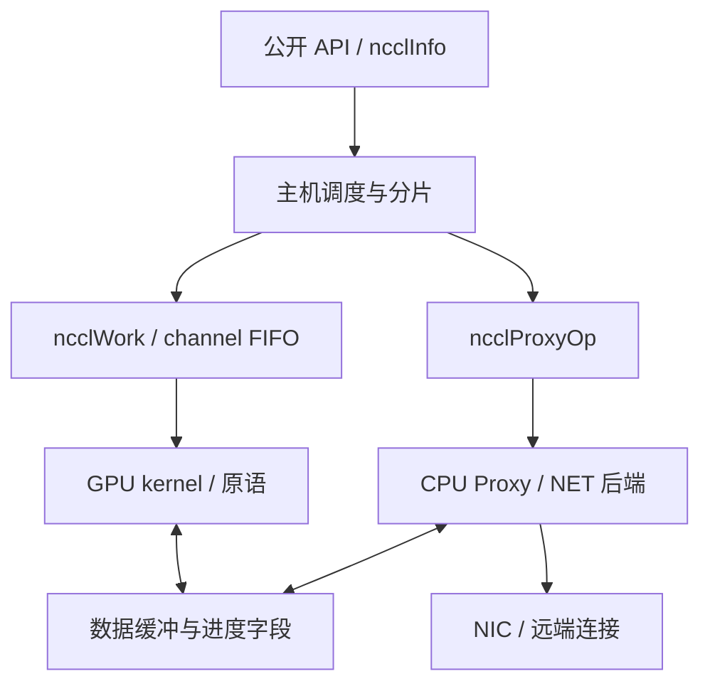

# NCCL 2.12.12 中文源码导读

本导读针对仓库 `maxiaoxuxu/nccl2.12.12.1`，分析基线提交为 `04832308d0885226169b9376c1ba4f17b0cb6484`。版本由 [version.mk](../../makefiles/version.mk) 确认：NCCL 2.12.12、PKG_REVISION=1。仓库名称末尾的“.1”是这里的打包修订号，不是 NCCL_PATCH=12.1。

讲解以源码内的“中文逐项”及“中文精读/中文导读”注释为主体。每个清单符号对应源码内说明，详见[根目录阅读入口](../../START_HERE_ZH.md)和[完整函数/类型索引](symbol-index.md)。建议从 [源码注释阅读入口](source-map.md) 开始，按问题定位到具体代码；其中包含各 API 的布局示例、分片公式、线程角色和调用衔接。

另有三份相互关联的说明：

- 本页：整体架构、数据结构、源码目录与阅读方法。
- [初始化、调度与 GPU 执行](execution.md)：从公开 API 追踪到设备原语，包含 Ring 实例和 P2P 调度。
- [Proxy、IB 与 QP/MR 资源](rdma.md)：解释网络状态机、连接复用、注册缓存、GDR flush、SRQ 和资源核算。

这些解释来自该提交的实现。文档里的示例计算会明确给出假设；不把较新 NCCL 的 NVLS、设备端网络发起或专用 EP 后端套到本版本。仓库没有 vLLM 代码，因此不能据此断言某个 vLLM 版本究竟创建多少 communicator 或采用何种专家通信后端。

## 1. 先理解 NCCL 做了哪些工作

一次 AllReduce 并非简单地在 CPU 上调用一次 RDMA send。NCCL 需要把同一个用户操作转成以下几部分：

1. 确认参与者、设备和用户缓冲区语义。
2. 决定怎样在 GPU/节点之间组织通信。
3. 决定每段数据使用哪些 channel、线程和协议。
4. 让 GPU 执行数据复制及归约。
5. 跨机时让 CPU Proxy 适时提交网络请求、检查完成并协调缓冲区复用。

下面两条运行分支必须理解同一协议与进度，否则 GPU 可能一直等待 Proxy，或 Proxy 一直等待 GPU：



同机 P2P 路径可以由 GPU 直接访问对端 GPU 映射，不需要每个数据块都通过 CPU 网络推进。跨机内置 IB 路径即使开启 GDR，仍然由 CPU Proxy 提交 verbs 操作；GDR 解决的是 NIC 访问 GPU 内存的问题。

## 2. 六个容易混淆的概念

| 概念 | 源码中的主要表示 | 实际含义 |
| --- | --- | --- |
| communicator | `ncclComm` | 一个通信组在本 rank 上的完整上下文 |
| channel | `ncclChannel` | 一条逻辑执行流水线，含拓扑、peer 表及 FIFO |
| peer | `ncclPeer` | 某个 channel 中一个 rank 的连接槽位集合 |
| connector | `ncclConnector` | 某 peer、方向和 connIndex 的逻辑连接 |
| NET connection | `netSendComm/netRecvComm` | 网络后端的一条发送/接收连接对象 |
| QP | `ibv_qp` | 内置 IB 后端实际创建的 verbs 硬件队列对 |

它们不是一一对应关系。一个 channel 有多个 peer 槽位；部分槽位可能从未建链。connector 可能选择 P2P/SHM，不创建 RDMA QP。多个 connector 在满足条件时可复用底层 NET connection；一个 IB connection 又可以创建多个数据 QP。

CUDA stream 则描述应用侧执行顺序。它既不是 channel，也不等同于网络连接。NCCL 将操作排入用户指定的 stream，不意味着每个 stream 都新增一套 QP。

## 3. 源码目录如何分工

| 路径 | 核心职责 | 建议优先阅读的入口 |
| --- | --- | --- |
| [src/collectives](../../src/collectives) | 公开通信 API 包装 | `all_reduce.cc`、`sendrecv.cc` |
| [src/init.cc](../../src/init.cc) | communicator 初始化、拓扑与连接建立、销毁 | `ncclCommInitRankSync`、`initTransportsRank` |
| [src/bootstrap.cc](../../src/bootstrap.cc) | 初始化 socket 控制面 | `bootstrapInit`、`bootstrapAllGather` |
| [src/enqueue.cc](../../src/enqueue.cc) | 检查、算法/协议选择、分片、FIFO 装填与发射 | `ncclEnqueueCheck`、`computeColl` |
| [src/group.cc](../../src/group.cc) | group 嵌套、延迟提交、P2P 分块与多 GPU 发射协调 | `ncclGroupEnd` |
| [src/graph](../../src/graph) | 硬件图、路径、通信图搜索和性能模型 | `topo.cc`、`paths.cc`、`search.cc`、`connect.cc`、`tuning.cc` |
| [src/transport.cc](../../src/transport.cc) | 按逻辑边选择 transport，交换句柄并连接 | `selectTransport`、`ncclTransportP2pSetup` |
| [src/transport/p2p.cc](../../src/transport/p2p.cc) | GPU P2P、CUDA IPC 与中间 GPU 路径 | `p2pCanConnect`、`p2pMap` |
| [src/transport/shm.cc](../../src/transport/shm.cc) | 同机共享主机内存通路 | `shmCanConnect`、setup/connect |
| [src/transport/net.cc](../../src/transport/net.cc) | 网络缓冲区、共享连接、映射与 Proxy 状态机 | `sendProxyConnect`、`recvProxyProgress` |
| [src/net.cc](../../src/net.cc) | 外部插件与内置 IB/Socket 后端选择 | `ncclNetInit` |
| [src/transport/net_ib.cc](../../src/transport/net_ib.cc) | RC QP、MR、地址发布、RDMA 操作与 CQ | `ncclIbConnect`、`ncclIbRegMr`、`ncclIbMultiSend` |
| [src/transport/net_socket.cc](../../src/transport/net_socket.cc) | Socket 网络数据后端 | connect/accept/isend/irecv/test |
| [src/proxy.cc](../../src/proxy.cc) | Proxy 控制服务、工作发布和数据推进循环 | `ncclProxyService`、`ncclProxyProgress` |
| [src/collectives/device](../../src/collectives/device) | GPU kernel、各 collective 算法及协议原语 | `common.h`、`all_reduce.h`、`prims_*.h` |
| [src/misc/ibvwrap.cc](../../src/misc/ibvwrap.cc) | 动态加载 libibverbs 和封装错误处理 | `wrap_ibv_symbols` |
| [src/include](../../src/include) | 主机/设备共享结构、接口及常量 | `comm.h`、`devcomm.h`、`proxy.h` |

`transport/net.cc` 和 `src/net.cc` 尤其需要分清：前者实现 NCCL 网络 transport 的缓冲与推进逻辑，后者选择具体网络函数表。它们不是两个同义文件。

## 4. ncclComm：一个 rank 的资源总入口

见 [comm.h](../../src/include/comm.h)。

同一个 communicator 中，每个 rank 都有自己的 `ncclComm`。它不位于所有机器共同映射的一块全局内存中。

| 字段组 | 代表字段 | 用途 |
| --- | --- | --- |
| 身份 | rank、nRanks、cudaDev、busId | 确定本 rank 及绑定 GPU |
| 主机/节点映射 | node、nNodes、localRank、rankToNode、nodeRanks | 区分节点内/节点间通信，生成调度顺序 |
| 拓扑 | topo、peerInfo | 保存硬件图和其他 rank 的属性 |
| channel | channels、nChannels、p2pnChannels、p2pnChannelsPerPeer | 保存可执行通道和 P2P 通道预算 |
| 连接位图 | connectSend、connectRecv | 每个 peer 哪些 channel 仍需建链 |
| 模型 | latencies、bandwidths、threadThresholds、maxThreads | 按消息大小选择执行策略 |
| 提交状态 | asyncOps、p2pSends、p2pRecvs、enqueueInfo | 保存 group 或 graph 相关工作 |
| 进度/错误 | opCount、collOpCount、fatalError、abortFlag | 操作标识、错误传播与设备中止 |
| CPU/GPU 桥接 | devComm、hostDevComm、proxyState | GPU 执行视图与 Proxy 资源入口 |

`opCount` 跟踪包含 P2P/collective 的发射，`collOpCount` 是集合操作计数。不能把任意一个计数直接当作当前驻留的硬件连接数。

本版本节点映射以源码识别到的主机与 rank 信息建立。你设计的“128 GPU 超节点”是硬件域概念，未必等于这里的一个 `node`；16 台服务器即使经专用互联连在一起，也需要检查 NCCL 实际识别的主机、GPU 可达性和拓扑描述。

## 5. channel：拓扑和任务队列的交汇点

见 [devcomm.h](../../src/include/devcomm.h)、[channel.cc](../../src/channel.cc)。

每个 channel 同时包含：

- `ring`：前驱、后继和内部顺序到用户 rank 的映射。
- `tree`：父节点和最多三个下行邻居槽位。
- `collTree`：CollNet 相关的直接连接拓扑。
- `peers/devPeers`：主机/设备可见的 connector 表。
- `workFifo` 及设备可访问的对应视图：待执行工作记录。
- CPU 的 FIFO 尾与 GPU 的消费索引。

同一 channel 存在 Ring 和 Tree 信息，并不意味着一次操作同时运行两套算法。调度器为工作选定其中一种。另一方面，初始化已经建立的不同算法连接可能同时驻留，因此“当前使用的边”与“已经分配的边”必须分别统计。

本版本 `MAXCHANNELS=32`，但这只是结构容量上限。Ring 初始搜索上限为 16，后续可以复制/限制；某个操作又可能只用其中一部分 channel。历史日志中的 8 或 16 通道都需要结合实际配置和搜索结果解读。

## 6. peer、connector 与 connIndex

在一个 channel 中：

```cpp
channel.peers[peer].send[connIndex]
channel.peers[peer].recv[connIndex]
```

这是查逻辑连接的位置。主机侧连接包含：

| 成员 | 职责 |
| --- | --- |
| connected | 是否已经完成建链 |
| proxyConn | 找到处理资源请求/数据推进的代理 |
| transportComm | 所选 transport 的回调表 |
| transportResources | transport 私有资源 |
| conn | GPU 原语所需缓冲和同步信息 |

本版本普通 Ring/Tree 建链使用索引 0，普通 Send/Recv 使用索引 1；CollNet 等专用分支另有安排。这个索引能解释为什么 API 点对点通信可能在已有 collective 连接之外再增加资源。

但 `NCCL_MAX_CONNS=2` 不表示“每对 rank 永远有两个 QP”。槽位可以未连接，transport 可以是本地路径，网络连接还可能共享或包含多个 QP。

## 7. GPU 连接视图 ncclConnInfo

`buffs[protocol]` 指向各协议使用的数据缓冲，`head/tail` 表示生产和消费进度，`step` 保留连接已经推进的位置，`sizesFifo/offsFifo` 为 GPU 与 Proxy 交换大小和共享池偏移。

例如发送环形缓冲只有 8 个 step 槽位，生产者不能因为要发送第 9 份数据就覆盖第 1 槽。它必须确认消费者已经推进，之后才能用同一物理槽位承载新的逻辑 step。槽位通过逻辑进度取模复用；进度本身不是每次操作都随意归零。

本地 P2P 场景中控制字段可能位于对端可访问映射；网络场景中 Proxy 代表 NIC 侧消费或生产数据。因此不要给所有路径的某个 head 指针套上完全相同的物理存放位置。

## 8. 工作描述：ncclInfo → ncclWorkElem → ncclWork

`ncclInfo` 是主机可修改的完整调度输入。它包含公开参数，也包含稍后补齐的 algorithm、protocol、nChannels、nThreads、pattern 等。

`ncclWorkElem` 是设备执行一个 collective 分片需要的信息。核心字段包括 sendbuff/recvbuff、count、bid、nChannels、root、归约参数和 header.funcIndex。

`ncclWork` 是 512 字节记录，可容纳多项 collective、P2P 或注册集合工作元素。固定大小与对齐便于 CPU/GPU 跨映射读取，并使 FIFO 索引规则简单。

CPU 并不是把整个 `ncclInfo` 复制到 GPU 后让 GPU 再搜索拓扑。拓扑搜索与任务编译已在主机端完成，GPU 消费的是更紧凑的执行描述。

## 9. GPU 端 communicator

`ncclDevComm` 只保留 rank、nRanks、协议缓冲区大小、abortFlag 和 channel 地址。初始化末尾的 `devCommSetup` 创建 `ncclDevCommAndChannels`，复制 channel、rank 映射与相关信息。

这种分层有两个目的：

1. GPU 只访问执行需要的数据，避免依赖 pthread/socket/verbs 等主机对象。
2. 主机可以维护复杂调度状态，而设备算法只依赖稳定的连接与工作格式。

`ncclKernel` 使用 blockIdx.x 找到对应 channel，把上下文复制到 CUDA shared memory 后执行工作。这里“shared memory”指 GPU 片上共享内存，与 SHM transport 的主机共享内存是两个不同概念。

## 10. 硬件图、通信图、执行协议分别回答什么问题

| 层 | 核心问题 | 典型表示 |
| --- | --- | --- |
| 硬件图 | GPU/NIC/PCI/NUMA 之间怎样连接、可走什么路径 | ncclTopoSystem、ncclTopoNode |
| 通信图 | 各 channel 按什么 rank 顺序通信、哪些 GPU 负责网络边 | ncclTopoGraph、ring/tree |
| 算法 | 怎样组织数据传播与归约 | Ring、Tree、CollNet |
| 协议 | 每个数据块怎样同步、编码及推进 | Simple、LL、LL128 |
| transport | 具体邻居边怎样访问内存/跨机传输 | P2P、SHM、NET |
| 网络后端 | NET 通过哪组回调执行 | 插件、IB、Socket |

例如“Ring + Simple + NET/IB + GDR”是可组合的不同层次，不是一组互相排斥的算法名字。

本版本 `NCCL_NUM_ALGORITHMS=3`，不存在 NVLS 算法枚举。拓扑里有 NVS 节点或数据经过 NVSwitch，不等于代码具有后续版本的 NVLS collective 算法。

## 11. 参数语义也会在进入调度时转换

见 [argcheck.cc](../../src/misc/argcheck.cc) 的 `ArgsCheck`：

- 先计算 count × datatype 的字节大小。
- 对 AllGather/Broadcast，把内部 count 改成字节数、datatype 改成 ncclInt8，方便纯复制执行。
- 对 AllGather/ReduceScatter，调度统计的 nBytes 再乘 nRanks，因为公开 count 是每 rank 的贡献或输出大小。
- Send 的数据指针放在 info.recvbuff 中，info.root 在 P2P 时用作 peer。

所以调试打印中的 nBytes 不一定等于某个公开 API count × 原始类型大小，也不一定是某个网口最终发出的精确字节量。协议 flag、分块对齐、收发方向和算法步骤都会影响实际流量。

## 12. 如何把一次操作与具体资源关联

建议从以下标识逐层跟踪：

1. communicator 地址和 rank：确认是哪一个通信组。
2. channelId、peer、方向、connIndex：确认逻辑连接。
3. transport 名称：确认是否走 NET。
4. netDev、proxyRank、netSendComm/netRecvComm 地址：确认实际网络出口及连接复用。
5. 数据 QPN、flush QPN、MR 地址范围及 key：确认硬件资源。
6. opCount、protocol、nsteps：确认哪次工作正在使用已有资源。

这套关联比只观察“alltoall 执行了多少次”可靠，因为多次操作经常复用同一连接和 MR；反过来，一次 group 也可能首次接触多个新 peer，从而触发多次建链。

## 13. 本次注释的范围与验证边界

注释覆盖初始化、bootstrap、拓扑搜索、调优、group、调度、GPU Ring/Tree/P2P、Simple/LL/LL128、transport、网络插件选择、Proxy、IB 连接及 MR 缓存等核心路径。并非给第三方 NVTX 头文件或每一个辅助函数逐行加注释。

验证首先保证已有源码在去掉新增“中文导读”块后与基线逐字节一致，并检查 Git 补丁格式及文档引用。本环境没有 nvcc/CUDA GPU，因此不把静态验证表述为完整编译或多机通信测试。读性能和硬件资源时，最终仍要用目标硬件、后端、环境配置及运行日志验证。

## V3：图解与函数内部步骤

[42张关键路径图解](visual-guide.md) · [离线图解](visual-guide.html) · [1178个函数内部步骤](function-logic-index.md) · [离线函数搜索](function-logic.html)。所有内部步骤也在源码的“中文内部逻辑”注释中。
